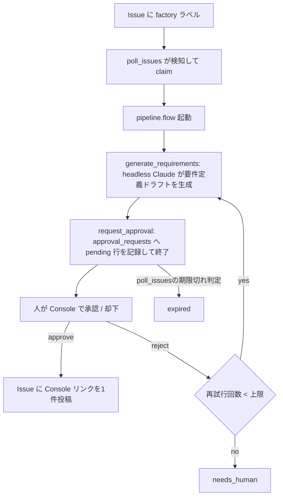
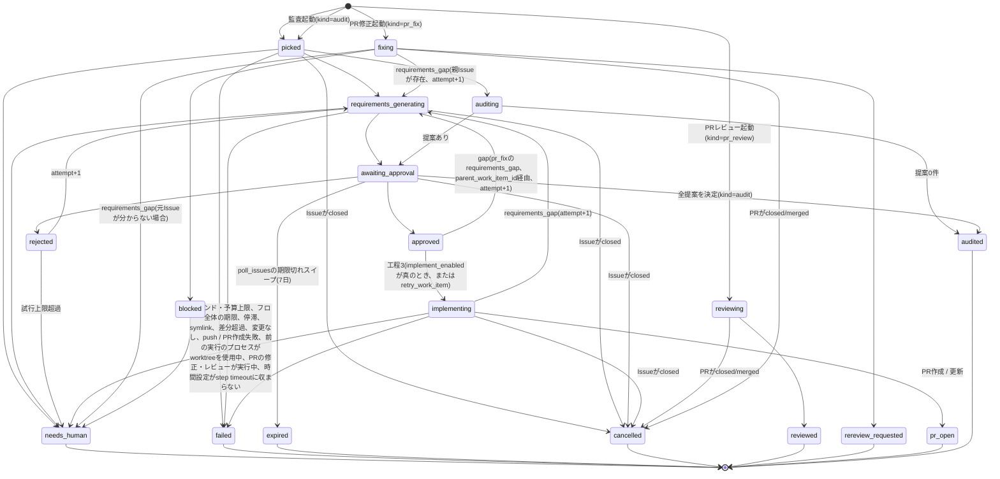

# アーキテクチャ

## 概要

Software FactoryはGitHub Issueを起点に、要件定義から自己改善までをWindmill上のフローとして自動化する仕組みである。

主なコンポーネントは次のとおり。

- **GitHub**: Issueの起票・ラベル付け・PR・コメントのやり取り先。`factory`ラベルが付いたIssueが入力になる。
- **Windmill server / worker**: フローとスケジュールの実行基盤。workerはカスタムイメージで動き、`claude`(Claude Code CLI)、`gh`、`gtr`(git worktree runner)、`wmill`を同梱する。workerはdefaultワーカーグループの1コンテナで、`NUM_WORKERS=3`により内部で3つのワーカープロセスが並列動作する(メモリ上限は1コンテナ分の4096Mのまま)。
- **Data Tables**: 作業の状態・要件定義ドラフト・承認履歴・実行ログ・失敗記録などを保持するPostgresベースのテーブル群。
- **App(ダッシュボード)**: 承認Inbox、要件定義書の一覧・全文表示(Confluenceの文書ページに近い見た目、図はインライン描画)、パイプラインの一覧、コスト等の分析、失敗の再実行、通知一覧、監査(監査レポートの一覧・全文表示と「今すぐ監査」)を提供するUI。
- **Discord**: 各イベント(拾い上げ、承認待ち、承認、却下、要対応、失敗など)をWebhook経由で通知する。

## パイプライン(工程1 → 5)

実装済みは工程1(作業を拾う)、工程2(要件定義の生成と承認・差し戻し)、工程3(承認済み要件定義からの実装とPR作成、PRレビュー・修正)、
工程5(自己改善)、ダッシュボード(Factory Console)、自己更新と失敗ハンドラ。工程3の実装とPR作成は配線済みだが、`factory_config`の`implement_enabled`(既定`false`)を有効にするまで起動しない。工程4は拡張点として後続で実装予定。

| 工程 | 内容 | 状態 |
| --- | --- | --- |
| 1. 拾う | `factory`ラベル付きIssueを検知してclaimする | 実装済み |
| 2. 要件定義 | headless Claudeが要件定義ドラフトを生成し、人が承認・差し戻しする | 実装済み |
| 3. 実装 | 承認済みの要件定義からworktree上で実装しPRを作成する(`implement`) | 実装済み(`implement_enabled`で有効化) |
| 3. PRレビュー・修正 | 既存PRをレビュー・修正する(`pr_review` / `pr_fix`) | 実装済み |
| 4. CI監視 | マージ後のCIを監視する | 未実装(拡張点) |
| 5. 自己改善 | 週次で運用記録を監査し、レポートと改善提案(承認後にFactory自身のリポジトリへIssue起票)を作る | 実装済み |

承認は`approval_requests`テーブルの`pending`行で待つ(Windmillのsuspendステップは使わない)。`request_approval`ステップは`kind = 'requirements'`の`pending`行を記録して即座に終了し、フロー自体はそこで完了する。人がConsoleから承認 / 却下すると`approval_decide`が決定を`approval_requests`へ記録し(`decideApprovalRequestIfPending`による楽観ロック)、`kind`に応じたapplyスクリプト(`steps/requirements_apply` / `steps/issue_proposal_apply`)を`runScriptByPathAsync`で起動して実際の反映処理を行う。期限(7日、`approval_requests.expires_at`)は`poll_issues`のreconcile後に行う期限切れスイープが判定し、`expired`への遷移と通知を行う。

工程2の要件定義書はテンプレート(`.claude/skills/factory-requirements/template.md`)を単一の正とし、生成物は`requirements_doc`で機械検査する。headless ClaudeのカレントディレクトリはIssue単位・試行単位の要件定義ファイル置き場(`/var/lib/factory/requirements/<owner>/<repo>/issue-<N>/wi-<work_item_id>/attempt-<attempt>/`、workerコンテナ専用のvolumeでコミットしない)そのものであり、`requirements.md`(テンプレートのコピー)を`Edit`で埋め、図があれば`<name>.drawio`を`Write`で書く。対象リポジトリのworktreeは`--add-dir`で読み取り専用に見せるだけで、カレントディレクトリにはしない。構造化出力は`{summary, open_questions}`に縮小し、本文と図は生成後にファイルから読み戻して検査・保存する(`f/factory/steps/pipeline_generate.ts`)。Factory ConsoleのbackendランナブルもCLIワーカーと同じworkerコンテナ(defaultワーカーグループ)で同じvolumeを読む前提であり、workerを複数コンテナに分ける場合は共有ストレージが必要になる。Console側の接続は`f/factory/steps/console_query.ts`の`requirements_doc`ビュー(query view。`f/factory/lib/requirements_doc.ts`の生成物検査ロジックとは別物)が`doc_dir`から`requirements.md`と各図のファイルを読み戻し、raw appの`components/RequirementsDocument.tsx` / `Markdown.tsx` / `DrawioViewer.tsx`がConfluenceの文書ページに近い見た目で本文・目次・図をインライン描画する形で実装済み(要件定義タブ、およびInboxタブの要件定義詳細の双方から使う)。`doc_dir`が読めない場合(pre-2026-09-27の行など)はDBの`markdown`列にフォールバックする。

## 状態遷移(work_items.status)

`awaiting_approval`の作業項目はflow jobが完了済みのまま人の決定を待つため、`poll_issues`のreconcileはこのstatusに孤児判定(job生死と猶予)を適用せず、Issue / PRのclose検知だけを行う。

reconcileはジョブの状態を`JobService.getJob`で読み、`flow_job_id`が未記録か取得が404なら「見つからない」として猶予(10分と`claude_timeout_sec`の2倍の大きい方)を過ぎてから孤児にする。404以外の取得失敗(Windmill APIの一時的な障害など)は「状態不明」として、Issue / PRのclose検知を除き何もしない。これはすべてのkind(pipeline / implement / pr_review / pr_fix / audit)に適用される。

### status一覧

| status | 意味 | 工程 |
| --- | --- | --- |
| `picked` | Issueをclaimした直後 | 1 |
| `requirements_generating` | 要件定義ドラフトを生成中 | 2 |
| `awaiting_approval` | 承認Inboxで承認待ち | 2 |
| `approved` | 要件定義が承認された | 2 |
| `rejected` | 却下され再生成待ち(attempt+1) | 2 |
| `needs_human` | 自動処理を打ち切り人の対応が必要(試行上限超過、requirements_gapの元Issue不在、等) | 2/PRワークフロー |
| `failed` | 実行時エラーで失敗 | 1/2 |
| `expired` | 承認タイムアウト(7日、`poll_issues`の期限切れスイープが判定) | 2 |
| `cancelled` | Issueがclosed | 1/2 |
| `implementing` | 実装中(worktree上で実装 → 検証と修正のループ → PR作成) | 3 |
| `pr_open` | 実装が完了しPRを作成した(終端。マージ後の追跡は工程4の課題で、レビュー・修正は`pr_review` / `pr_fix`側の作業項目が担う) | 3 |
| `reviewing` | PRレビューを実行中(`kind=pr_review`) | PRワークフロー |
| `reviewed` | PRレビューをCOMMENTとして投稿済み(終端、`kind=pr_review`) | PRワークフロー |
| `fixing` | レビュー指摘・コメントの修正を実行中(`kind=pr_fix`) | PRワークフロー |
| `rereview_requested` | 修正をpushし再レビューを依頼した(終端、`kind=pr_fix`) | PRワークフロー |
| `blocked` | 禁止された変更パターンの検出、差分上限超過、または安全策の前提が崩れて中断(`kind=pr_fix`) | PRワークフロー |
| `auditing` | 監査を実行中(`kind=audit`) | 5 |
| `audited` | 監査完了(終端、`kind=audit`) | 5 |

**終端statusの同期**: 終端status(`approved` / `rejected` / `needs_human` / `failed` / `expired` / `cancelled` / `reviewed` / `rereview_requested` / `blocked` / `audited` / `pr_open`)の一覧は`f/factory/lib/types.ts`の`TERMINAL_WORK_ITEM_STATUSES`と、Data Tableのview`factory.v_lead_time`の`WHERE status IN (...)`の2か所にある。終端statusを増やすときはmigrationで`v_lead_time`を`CREATE OR REPLACE`し、同じPRで`TERMINAL_WORK_ITEM_STATUSES`を更新する(`poll_issues`のreconcileは終端statusを`listActive`から外して孤児判定の対象にしないため、片方だけ更新すると完了済みの作業項目が孤児として`failed`にされる)。

**Issue・PR共通(2026-09-27方針変更)**: トリガーラベル(Issueの`factory`、PRの`factory:review` / `factory:fix`)はclaim時(Issueはassignee付与直後、PRはトリガーラベル自体の削除直後)に一度だけ消費する。以降のどの状態遷移(終端遷移を含む)でもIssue / PR側のラベルは付け外ししない。状態は`work_items.status`のみが正で、GitHubのラベルは「人からFactoryへのトリガー」の役割に限定される。`retry_work_item`のように終端statusから再起動する経路も、`runFlowAsync`を呼ぶだけでラベルの再付与は行わない。最初からやり直すには人が改めてトリガーラベルを付け直す(新しいcycle)。

PRは終端statusになってもトリガーラベルの消費以外の付け外しが起きないため、再発見はGitHub検索(`searchPrs`)ではなくDB(`work_items`)側で行う。`poll_prs`の`listTrackedPrs`が`kind IN ('pr_review', 'pr_fix')`かつ`status != 'cancelled'`かつ`tracked_pr_days`(既定30日、`factory_config`)以内に更新された行を再発見し、そのPRがまだopenであることを`getPr`で確認してから候補にする。人が新しいcommitをpushすれば(pr_reviewの場合)、または改めてトリガーラベルを付け直せば、この再発見経路から自動的に次のサイクルが始まる。

### 状態遷移の詳細

**工程2(要件定義)から工程3へ:**
- `approved` → `implementing`: `requirements_apply`が承認の副作用(Issueコメント、Discord、`req-<N>` worktreeの削除)の後に、`implement_enabled`が真ならCASで遷移させ(同じ文で`flow_job_id`を空にする)、`f/factory/implement`を起動して、`flow_job_id`が空か同じ値のときだけ起動したジョブIDを記録する。`runFlowAsync`はHTTPエラーでも例外を投げないので、戻り値がジョブID(UUID)でなければ起動失敗として扱う。起動に失敗したら、フローがまだリースを取っていなければ`needs_human`にし、`job_failures`に記録してConsoleのFailuresタブから再実行できるようにする。起動はエラーでもフローが既にリースを取っていれば、動いているので何もしない。
- `implementing` → `pr_open`: 検査に通った(または保護パス変更・検査コマンド未設定で検査を実行しなかった)実装をコミットしてpushし、PRを作成または更新して`factory:review`ラベルを付けた。
- `implementing` → `requirements_generating`: 実装が`requirements_gap`を返した。worktreeを削除し、PRが無ければ実装ブランチ(リモートとローカル)も削除して、`gap_report`をfeedbackに工程2をattempt+1で再起動する(`max_attempts`を超えたら`needs_human`)。
- `implementing` → `needs_human`: ラウンド上限・日次予算・フロー全体の期限(修正ラウンドを始める時間が残っていない)・停滞・symlink変更・差分超過・Claude実行失敗・変更なし・push / PR作成失敗・時間設定がstep timeoutに収まらない(準備ステップで止める)。秘密情報の検査に通れば途中の変更をブランチにpushしてから止める。この途中経過のコミットと、再実行が成功したときの実装コミットは別コミットになる(1コミットにまとめるのは通常の経路のみ)。
- `implementing` → `cancelled`: Issueがclosedになった(準備時と完了時に確認する。実行中は`poll_issues`のreconcile)。

**実装フローのリース(二重実行の防止)**: `implementing`の作業項目の`flow_job_id`は実装フローのリースとして扱う。`implement_prepare`は最初に(worktreeに触る前に)、statusが`implementing`で`flow_job_id`が空か自分のルートジョブID(`WM_ROOT_FLOW_JOB_ID`。`runFlowAsync`の戻り値と同じ値)のときだけ自分のIDを書き込み、書き込めなければ何もせずに終わる(読み直した`flow_job_id`と自分のIDをログに残す)。Issueのcloseによる取り消し(`cancelJob`の失敗は無視される)やpr_fixの差し戻しで、実行中にリースが移ることがあるので、`implement_generate`はClaudeを実行する前に、`implement_verify`は各ラウンドの冒頭(worktreeに触れる前)と各修正ラウンドの前に、`implement_finish`は作業項目を読んだ直後と外への副作用(commit・push、worktreeとリモートブランチの削除、PRの作成と更新、`pr_url`の記録、ラベル)の直前にリースを確かめ、失っていれば何もせずに終わる。`implement_finish`の状態の遷移はすべて`flow_job_id`が自分のIDであることを条件にする。`retry_work_item`は記録されたジョブがまだ動いているか状態を読めなければ再実行を拒否する。`poll_issues`のreconcileと`on_error_flow`は、読み取った時点の`flow_job_id`が変わっていないときだけ作業項目を`failed` / `cancelled`にする。Windmillのrerunは新しいジョブIDで最初から走るので、準備の最初で何もせずに終わる。途中のステップからのrestartも新しいジョブIDで走るので、再開したステップの最初のリースの確認(`implement_generate`、`implement_verify`、`implement_finish`)で何もせずに終わる。どちらも、元の実行で進行中のClaudeの実行や検査を中断はしない(再実行は`retry_work_item`を使う)。

**PRワークフローの`requirements_gap`:**
- `pr_fix`フロー実行中に`outcome: "requirements_gap"`が返された場合、`parent_work_item_id`で元Issueの作業項目を特定する。
- 元Issueが存在する場合、その作業項目を`requirements_generating`にattempt+1で再起動(issueの工程2に戻す)。
- 元Issueが見つからない場合(PRがFactory製ではなくmanualで投入された場合など)は`needs_human`に遷移。

## データモデル

Data Tablesはスキーマ`factory`に置く。migrationは追加のみで、renameは禁止する(列定義の詳細はmigrationファイル自体を正とする)。

### テーブル

| テーブル | 役割 |
| --- | --- |
| `work_items` | Issue単位の作業状態。`(owner, repo, issue_number, cycle)`で一意。工程3用の`branch`(実装ブランチ`factory/issue-<N>-wi-<id>`)と`pr_url`(作成したPRのURL)は`kind=issue`のみが持ち、それ以外はnull。`pr_number`はPR側の作業項目(`pr_review` / `pr_fix`)の束ね方に影響するためIssue側には入れない |
| `work_item_events` | 状態遷移のイベント履歴 |
| `requirement_drafts` | 要件定義ドラフト(markdown、図の参照`{name, file}`、未確定事項、`doc_dir`)。attemptごとに保存。図のXML自体はDBではなく`doc_dir`配下のファイルにある |
| `approvals` | 旧テーブル。過去の承認・却下履歴のみを保持し、新規の書き込みはない(`approval_requests`に統一済み) |
| `agent_runs` | Claude実行1回ごとのログ(トークン数、コスト、所要時間、終了コード等) |
| `job_failures` | フロー実行時のエラー(トークンはマスク済み) |
| `deployments` | self_updateによるデプロイ結果 |
| `notices` | 要対応事項(PAT失効、SHA不一致など) |
| `audit_reports` | 監査1回のレポート。作業項目と1対1、`markdown`が正、`metrics`に証跡の数値 |
| `issue_proposals` | pr_fixの`propose_issue`返信が提案するIssue(title / body)と、その承認 / 却下の判断履歴。`title` / `body` / `review_comment_id` / `thread_id`の一次情報源(`approval_requests`はこれらを複製しない)。`origin`(`pr_fix` / `audit`)。auditは`audit_report_id` / `position`で紐づき`review_comment_id`はnull |
| `approval_requests` | 承認依頼の汎用テーブル。`kind`は`requirements`(要件定義承認、`subject_id`は`requirement_drafts.id`)/ `issue_proposal`(Issue化提案、`subject_id`は`issue_proposals.id`)、`status`は`pending` / `approved` / `rejected` / `expired`。`approval_decide`が読み書きする唯一のテーブルで、suspendベースの承認と`approvals`テーブルへの書き込みを置き換えた |
| `cleanup_runs` | `cleanup_db`が実行するたびの削除件数の記録(作業項目・失敗記録・デプロイ記録・通知など) |
| `implement_rounds` | 工程3のClaude実行1ラウンドごとの記録。`round`は作業項目内で連番(`UNIQUE (work_item_id, round)`)、`mode`(`implement` / `fix`)、`outcome`(`done` / `requirements_gap` / `check_failed` / `checks_skipped` / `stalled` / `error`)、`summary` / `gap_report` / `check_output`(先頭16KB)/ `checks_skipped_reason` / `protected_changes`(jsonb、保護パス変更の一覧)/ `diff_stat`(jsonb `{files, added, deleted}`)/ `agent_run_id`。作業項目の削除に連動して消える |

### view(Appはこれらのみを参照する)

`v_inbox`、`v_pipeline`、`v_agent_cost_daily`、`v_approval_stats`、`v_lead_time`、`v_failures`、`v_notices`、`v_issue_proposals`、`v_approval_requests`、`v_audit_reports`

## フローとスケジュール

| 名称 | 種別 | 概要 |
| --- | --- | --- |
| `poll_issues` | schedule(5分毎) | Issueの検知・claim・reconcile(closed検知、孤児ジョブ検知)・再投入検出・承認依頼の期限切れスイープ |
| `manual_intake` | flow(フォーム起動) | フォーム入力からIssueを作成し同じパイプラインに乗せる |
| `pipeline` | flow | 要件定義生成 → 承認依頼の記録(`approval_requests`)。承認 / 却下 / タイムアウトの分岐はフロー外(`approval_decide`とpoll_issuesの期限切れスイープ)で行う |
| `implement` | flow | 承認済み要件定義からの実装 → 検証と修正のループ(gitleaksと検査コマンド)→ コミット・push・PR作成。`requirements_apply`が`implement_enabled`のときだけ起動する |
| `self_update` | schedule(10分毎) | self cloneをpullし、変更があれば`wmill sync push`とmigrationを適用する |
| `cleanup_workspaces` | schedule(毎日03:00) | 期限切れworktree(`req-<N>`、`work_items.branch`の実装worktree、review-*、pr_fixのgtr worktree)の削除、孤児化したheadless Claudeプロセスの停止、ディスク使用量の記録 |
| `cleanup_db` | schedule(毎日03:30) | 保持期限を過ぎたDBのレコード(終端状態の作業項目とその関連データ、失敗記録・デプロイ記録・解決済みの通知)の削除 |
| `daily_summary` | schedule(毎日09:00) | 前日のコスト・件数・失敗・DB掃除件数をDiscordに通知 |
| `audit_kickoff` | schedule(毎週月曜09:30) | 前回監査以降の運用記録を集計し、対象があれば監査の作業項目を作成して`audit`フローを起動 |
| `audit` | flow | 証跡パックの収集と監査レポート・改善提案の生成(headless Claude)、提案の承認登録 |

各scheduleのcronはタイムゾーン`Asia/Tokyo`、Windmillの6フィールド形式で`*.schedule.yaml`に持つ。多重実行防止はadvisory lockを使わず、各scheduleの`no_flow_overlap: true`で行う(前回実行中はスキップする)。複数インスタンスを同時運用する場合の排他はWindmill側ではなくGitHub側のclaim(Issueはassignee付与、PRはトリガーラベルの消費。いずれも再取得して確認する)で確保する。error handlerで失敗を記録し、すべてのフロー(pipeline / implement / pr_review / pr_fix)の`failed`終端処理(Discord通知。ラベルはclaim時に既に消費済みのため除去は行わない)は`on_error_flow`に一本化される。承認のタイムアウト(7日)は`poll_issues`のreconcile後に行う期限切れスイープが`approval_requests.expires_at`を見て判定する(`pipeline.flow`はsuspendを使わない)。

## 命名規則

WindmillのUIはsummaryでソートされるため、種別を示すタグをsummaryの先頭に付ける(pathは英数字のみに固定し変更しない)。

| タグ形式 | 対象 |
| --- | --- |
| `[SF-<工程>-<順>] <日本語の表示名>` | 自動フロー / schedule |
| `[SF-<工程>-<順>/<n>] <日本語>` | フロー内ステップscript |
| `[OP-<工程>-<順>] <日本語>` | 人がUIから手動実行するもの |
| `[SYS-<順>] <日本語>` | 基盤・運用の自動処理 |
| `[LIB] <日本語>` | 共有ライブラリ |

工程番号は1=作業を拾う、2=要件定義、3=実装・PR、4=CI監視、5=自己改善に対応する。

### 割り当て表

| path | summary |
| --- | --- |
| `f/factory/poll_issues`(script + schedule) | `[SF-1-1] Issue を巡回して担当を確定` |
| `f/factory/poll_prs`(script + schedule) | `[SF-1-2] PR を巡回してレビュー / 修正を起動` |
| `f/factory/manual_intake__flow` | `[OP-1-1] 手動投入フォーム(Issue を作成して工程に乗せる)` |
| `f/factory/steps/manual_intake_create_issue` | `[OP-1-1/1] Issue を作成` |
| `f/factory/steps/manual_intake_register` | `[OP-1-1/2] 作業項目を登録して工程 2 を起動` |
| `f/factory/pipeline__flow` | `[SF-2-1] 要件定義の生成と承認` |
| `f/factory/steps/pipeline_prepare` | `[SF-2-1/1] 作業領域の準備` |
| `f/factory/steps/pipeline_generate` | `[SF-2-1/2] 要件定義の生成(Claude)` |
| `f/factory/steps/pipeline_request_approval` | `[SF-2-1/3] 承認依頼` |
| `f/factory/steps/requirements_apply` | `[SF-2-2] 要件定義の承認結果を反映` |
| `f/factory/approval_decide` | `[OP-2-1] 承認 / 差し戻しを記録して反映` |
| `f/factory/retry_work_item` | `[OP-2-2] 作業項目を再実行` |
| `f/factory/pr_review__flow` | `[SF-3-1] PR の自動レビュー` |
| `f/factory/steps/pr_review_prepare` | `[SF-3-1/1] PR の取得と検証` |
| `f/factory/steps/pr_review_generate` | `[SF-3-1/2] レビューの生成(Claude)` |
| `f/factory/steps/pr_review_post` | `[SF-3-1/3] レビューの投稿` |
| `f/factory/pr_fix__flow` | `[SF-3-2] レビュー指摘の修正と再レビュー依頼` |
| `f/factory/steps/pr_fix_prepare` | `[SF-3-2/1] worktree の準備と安全確認` |
| `f/factory/steps/pr_fix_collect` | `[SF-3-2/2] 指摘の収集` |
| `f/factory/steps/pr_fix_apply` | `[SF-3-2/3] 修正の適用(Claude)` |
| `f/factory/steps/pr_fix_verify` | `[SF-3-2/4] 変更の検証` |
| `f/factory/steps/pr_fix_finish` | `[SF-3-2/5] push と再レビュー依頼` |
| `f/factory/steps/issue_proposal_apply` | `[SF-3-3] Issue化提案の承認結果を反映` |
| `f/factory/implement__flow` | `[SF-3-4] 実装とPR作成` |
| `f/factory/steps/implement_prepare` | `[SF-3-4/1] 作業領域の準備` |
| `f/factory/steps/implement_generate` | `[SF-3-4/2] 実装(Claude)` |
| `f/factory/steps/implement_verify` | `[SF-3-4/3] 検証と修正のループ` |
| `f/factory/steps/implement_finish` | `[SF-3-4/4] コミット・push・PR作成` |
| `f/factory/steps/pr_workflow_support` | `[LIB] PR ワークフロー共通処理` |
| `f/factory/self_update`(script + schedule) | `[SYS-1] Software Factory 自身を最新化` |
| `f/factory/cleanup_workspaces`(script + schedule) | `[SYS-2] 作業領域を掃除` |
| `f/factory/notify_daily_summary`(script + schedule) | `[SYS-3] 日次サマリ通知` |
| `f/factory/on_error_flow` | `[SYS-4] フロー失敗ハンドラ` |
| `f/factory/on_error_schedule` | `[SYS-5] schedule 失敗ハンドラ` |
| `f/factory/cleanup_db`(script + schedule) | `[SYS-6] DB を掃除` |
| `f/factory/audit_kickoff`(script + schedule) | `[SF-5-1] 週次監査の起動` |
| `f/factory/audit__flow` | `[SF-5-2] 運用記録の監査と改善提案` |
| `f/factory/steps/audit_prepare` | `[SF-5-2/1] 証跡の収集と作業領域の準備` |
| `f/factory/steps/audit_generate` | `[SF-5-2/2] 監査レポートと提案の生成(Claude)` |
| `f/factory/lib/audit_support` | `[LIB] 監査の期間計算と起動判定` |
| `f/factory/lib/audit_evidence` | `[LIB] 監査の証跡収集` |
| `f/factory/lib/audit_doc` | `[LIB] 監査レポートの検査` |
| `f/factory/lib/config` | `[LIB] 設定の読み込み` |
| `f/factory/lib/db` | `[LIB] Data Table アクセス` |
| `f/factory/lib/github` | `[LIB] GitHub API ラッパー` |
| `f/factory/lib/workspace` | `[LIB] git worktree と作業領域` |
| `f/factory/lib/claude` | `[LIB] headless Claude 実行` |
| `f/factory/lib/drawio` | `[LIB] draw.io 図の生成` |
| `f/factory/lib/discord` | `[LIB] Discord 通知` |
| `f/factory/lib/log` | `[LIB] ログとマスク` |
| `f/factory/lib/prompts` | `[LIB] プロンプト定義` |
| `f/factory/lib/types` | `[LIB] 共通型` |
| `f/factory/lib/poll_support` | `[LIB] 巡回の純粋ロジック` |
| `f/factory/lib/summary_support` | `[LIB] 日次サマリの集計` |
| `f/factory/lib/approval_support` | `[LIB] 承認依頼の純粋ロジック` |
| `f/factory/factory_console__raw_app` | `[OP-0-1] Factory Console(承認・進捗・分析)` |
| `f/factory/steps/console_query` | `[OP-0-1/1] Console 用データ取得` |
| `f/factory/lib/self_update_support` | `[LIB] 自己更新の純粋ロジック` |
| `f/factory/lib/cleanup_support` | `[LIB] 作業領域掃除の純粋ロジック` |
| `f/factory/lib/requirements_template` | `[LIB] 要件定義テンプレートの定義` |
| `f/factory/lib/requirements_doc` | `[LIB] 要件定義ファイルの検査` |
| `f/factory/lib/cleanup_db_support` | `[LIB] DB 掃除の純粋ロジック` |
| `f/factory/lib/implement_support` | `[LIB] 実装フローの純粋関数群` |
| `f/factory/lib/protected_paths` | `[LIB] 保護パスの判定` |
| `f/factory/lib/implement_loop` | `[LIB] 実装フローの検証ループ` |
| `f/factory/lib/implement_finish_support` | `[LIB] 実装フローの完了処理の判定` |
| `f/factory/lib/implement_launch_support` | `[LIB] 実装フローの起動判定` |

## PRワークフロー(pr_review / pr_fix)

工程1→2(Issueの要件定義)とは別に、既存のPR(人が作ったPR、または将来Factory自身が作るPR)をレビュー・修正するワークフローを持つ。

- **起動条件**:
  - `pr_review`: PRに`factory:review`ラベルが付与されたとき(claim時にラベルを消費)、またはPRのreview-requested / assigneeがこのインスタンスのGitHubアカウントで、`head_sha`が未処理のとき(このパスはラベルを伴わないため消費するものがない)。
  - `pr_fix`: PRに`factory:fix`ラベルが付与されたとき(claim時にラベルを消費)。修正への指示は、ラベルを付ける前にPRへ通常のコメントとして書いておく(他の人間のコメントと同様にフィードバックとして収集される)。
- **自己再発火の防止**: Factoryが投稿するIssueコメント・PRレビュー・レビュー返信には必ずmarker(`<!-- factory:<kind>:<work_item_id> -->`)を埋め込む。GitHub上の自分のログイン名と一致する投稿、またはmarker付きの投稿は「人間の入力」として扱わず、起動条件の判定から除外する。
- **作業ディレクトリ**: `/workspaces/<owner>/<repo>/main`はfetch専用(working treeをcheckoutしない)。
  - `pr_review`は`git worktree add --detach /workspaces/<owner>/<repo>/review-<pr>-<sha7> <sha>`でPRごとのdetached worktreeを使い、終了時に削除する。
  - `pr_fix`は`git gtr new`で作るPRブランチのworktreeを使う。
- **pr_review**: PR本文・差分・変更ファイル一覧(Factory製PRなら承認済み要件も)を入力にレビューし、結果は常にGitHubのCOMMENTレビューとして投稿する(スキル内部の`verdict`は記録用で、投稿種別には反映しない)。完了すると`reviewed`(終端)。
- **pr_fix**: レビュー指摘・未解決コメント・要件を入力に修正し、push後に各コメントへ返信して再レビューを依頼する(`rereview_requested`)。要件変更が必要な場合は自分で要件や設計を書き換えず`requirements_gap`として中断し、元Issueの作業項目(`parent_work_item_id`で紐付け)を`requirements_generating`にattempt+1で戻す。安全策の詳細は[docs/security.md](security.md)を参照。
- **propose_issue(Issue化提案、ユーザー決定2026-09-26)**: pr_fixの各返信は`fixed` / `skipped`に加え`propose_issue`を選べる。指摘は妥当だがこのPRの範囲外という判断で、Claudeは修正を強行せずIssueのtitle/bodyを`factory.issue_proposals`に記録する(`pr_fix_finish`が挿入し、レビューコメントのthread idを`listReviewThreads`でベストエフォート解決する)。1件でも提案があるその回のpr_fixは`rereview_requested`ではなく`needs_human`で終わり、Discordに`ConsoleのInboxで提案を承認または却下してください`という通知が送られる。人が`f/factory/approval_decide`(Console Inboxから、kind = issue_proposal)で承認すると、`f/factory/steps/issue_proposal_apply`がその提案のIssueを対象リポジトリに作成してスレッドへ返信・resolveし、却下すると理由を返信してスレッドは開いたままにする(承認・却下いずれも要件定義の承認と同じ「人が判断してから進む」枠組み)。対象の作業項目の提案がすべて決定すると、status(`work_items.status`)はその回でコミットをpushしていれば`rereview_requested`、していなければ`reviewed`へ切り替わる(`decidePostProposalStatus`、pr_workflow_support.ts)。返信対象がPRレビューコメントかプレーンなissueコメントかは行挿入時に`is_inline`列へ記録し(`matchReviewThreadForComment`もコメントの`databaseId`で一致させ、`(path, line)`には依存しない)、`issue_proposal_apply`はそれをもとに決定的に返信先を選ぶ。承認は`decided_by`(要件定義の承認と同じfail-closed導出)と`status = 'pending'`条件付きUPDATEによる楽観ロック、作成したIssue本文へ埋め込む`<!-- factory:issue_proposal:<id> -->`マーカー(`findIssueByMarker`で再検索して再利用)によって、途中でクラッシュしても再実行が安全になっている(Issueの二重作成や決定の上書きは起きない)。詳細な手順は[docs/operations.md](operations.md)の「Issue化提案の承認 / 却下」を参照。
- **PRに書くのはレビュー本体と返信のみ**: pr_reviewの指摘・総評とpr_fixの返信だけをPRに投稿する。失敗・要人手・ブロック・requirements_gap・Issue化提案の承認/却下結果といった運用系の内容は、PRに書かずDiscordに通知する(Issue化提案の承認/却下自体への返信はPRのスレッドに書く。上記参照)。
- **DB上の追跡と再発見(2026-09-27方針変更)**: Factoryが扱ったPRにトリガーラベル以外のラベルは付かない。人が今このPRが何を待っているか確認するのはConsoleのPipelineタブ(`work_items.status`)で行う。`poll_prs`の`listTrackedPrs`(lib/db.ts)が`kind IN ('pr_review', 'pr_fix')`かつ`status != 'cancelled'`かつ`tracked_pr_days`以内に更新された行をDBから再発見するので、トリガーラベルが外れた後も追跡が続く(詳細は[docs/operations.md](operations.md)の「ラベルと終端状態」を参照)。
- **watermark**: 処理済みwatermark(`last_review_id` / `last_comment_id` / `last_review_comment_id`)はpr_fixがpushに成功したとき、またはrequirements_gapで元Issueへ差し戻したときにのみ進める。それ以外の終端(`failed` / `needs_human` / `blocked`)では進めず、`retry_work_item`による再実行で同じフィードバックを再収集できるようにする。push成功時にIssue化提案があって`needs_human`に終わる場合も、watermarkは(pushが実際に成功しているため)通常のpush成功と同様に進める。

## 自己更新の仕組み(self_update)

1. worker内のself clone(このリポジトリ自身)をpullする。SHAが変わっていなければ何もしない。
2. 変更があれば、Console raw appの依存を`npm ci`で揃えたうえで`wmill sync push --yes --keep-deleted`と`wmill datatable migrate up`をworker内から実行し、Windmill側のscript/flow/scheduleとData Tableの定義を最新化する。
3. `infra/**`(workerイメージやcompose定義)、または`mise.toml`の`[tools]`(ツールのバージョン)・`[env]`(composeが読む環境変数)セクションに変更がある場合は、workerの自己更新だけでは反映できないため`deployments.needs_host_action = true`として記録し、ログに残す。通知はしない。これらの変更は、ホスト側checkoutをpullしたうえで次に`mise run up`(`docker compose up -d --build`)で起動したときに反映される。一括で反映したいときは`mise run deploy`(ホスト側checkoutで`git pull --ff-only` → worker imageのビルド → `compose up -d` → `wmill sync push` → migration)を手動で実行する。
4. Claudeが参照するスキル(`.claude/skills/**`)はself cloneを`--add-dir`で直接読むため、pull直後から反映される。
5. 初回の反映(schedule自体の登録や初回push)は`scripts/bootstrap.sh`がホストから行う。

## 工程5: 自己改善(監査)

- **起動**: `audit_kickoff`(毎週月曜09:30のschedule、Consoleの「今すぐ監査」で前倒し可)が条件を判定し、満たせば作業項目(`kind=audit`)を作成して`audit`フローを起動する。
- **期間**: 対象期間は前回レポート終了時刻から実行日のJST 00:00まで(実行日当日は含めない)とし、`max_lookback_days`(既定28日)を上限に切り詰める。切り詰めた日数は`unaudited_gap_days`として証跡に記録する。
- **スキップ条件**: 別の監査が実行中(`picked` / `auditing`)、期間が空、対象期間に行動につながる記録が無い(強制実行時を除く)、日次予算超過のいずれかであれば起動をスキップする。スキップは記録のみで通知しない。
- **準備**: `audit_prepare`が作業項目を`picked`から`auditing`へ進め、証跡パック(サニタイズ済み)を作り、Factory自身のself cloneを同期する(Claudeに渡す使い捨てのスナップショットは`audit_generate`が作る)。ステップの再試行は`auditing`のまま再開し、二重に状態遷移しない。
- **生成**: `audit_generate`はheadless Claudeにテンプレートと証跡パックを与えレポートと改善提案を生成させ、章立て・改善提案の表・URL許可リストを機械検査してから保存する。保存済みレポートがある再開時はClaudeを再実行せず、提案登録と承認依頼の作成だけをべき等にやり直す。
- **提案と承認**: 提案は`issue_proposals`(`origin=audit`)として登録し、各提案に承認依頼(`kind=issue_proposal`)を作る。提案が0件なら作業項目は`audited`、1件以上あれば`awaiting_approval`に進み、全提案の承認 / 却下が終わると`audited`になる。
- **起票**: 承認された提案はFactory自身のリポジトリ(`factory_repo`)にIssueとして起票される。監査は`retry_work_item`による再実行の対象外で、失敗した期間は次回の週次監査か「今すぐ監査」でカバーする。
- **通知**: Discordの`audit_completed`通知は提案が1件以上あるときのみ送る。スキップやゼロ件のレポートは通知しない。

## 拡張点

### 工程3: 実装(配線済み、`implement_enabled`で有効化)

`f/factory/implement`フローは配線済みで、`factory_config`の`implement_enabled`(既定`false`)を有効にしたときだけ`requirements_apply`が承認後に起動する。

- **準備**(`implement_prepare`): 最初に`flow_job_id`のリースを取る(取れなければ何もせずに終わる)。statusが`implementing`か、日次予算、対象リポジトリ、Issueがopenか、作業項目のattemptに一致する承認済み要件定義があるかを確認し、実装ブランチ`factory/issue-<N>-wi-<id>`のworktreeを`git gtr`で用意して空のブランチをpushする(以後のpushは既存の`commitAndPush`をそのまま使う)。ブランチがデフォルトブランチから分かれた点(`git merge-base`)を比較の基準として後段に渡す。Claudeに渡すIssueの題名・本文・URLは取り込み時点のもの(`work_items.title` / `body` / `issue_url`。工程2の要件定義生成と同じ入力)で、GitHubのIssueはopenかどうかと、取り込み時点のURLが空のときのURLにだけ使う。
- **実装**(`implement_generate`): `factory-implementation`スキルのheadless Claudeをworktree上で1回実行する(`Read,Glob,Grep,Edit,Write`のみ、Bashなし)。承認済み要件定義のディレクトリは実行ごとに一時ディレクトリへ複製したものを読ませ、元のファイルは書き換えられない。Claudeを実行する前にリースを確かめ、失っていれば実行せずに、検証ループがそのまま止まる結果(`lease_lost`)を返す。モジュールの再試行は付けない。
- **検証と修正のループ**(`implement_verify`、`lib/implement_loop.ts`): ラウンドごとに、差分をすべてステージして指紋(`git write-tree`)と分岐点からの差分量を取り、分岐点からの変更パス(`git diff -z --name-status`)でsymlink変更と差分超過を検出したら止める。保護パスの変更は記録だけ行う。分岐点から何も変わっていないラウンドは合格にしない。続いてgitleaks(固定検査)と、保護パスを変えていなければリポジトリの検査コマンド(`check_commands_by_repo`に明示されたものだけ。無視ファイルを`git clean -fdX`で消してから)を実行し、失敗していればその出力をDATAとしてClaudeに修正させる。検査に通る、検査を実行しない、ラウンド上限・日次予算・期限・停滞、`requirements_gap`のいずれかで抜け、Claude実行ごとに`implement_rounds`へ1行記録する。検査コマンドは`implement_check_timeout_sec`をコマンドごとのタイムアウトとして最後まで実行する。Claude実行は、`implement_timeout_sec`と、準備の開始から`implement_flow_timeout_sec`後の期限(`ImplementContext.deadline_at`)までの残りの短い方で打ち切る。検査に失敗したラウンドの後は、残りが修正ラウンドの最悪の所要時間(`fixRoundWorstCaseSec`)以上のときだけ修正ラウンドを始め、足りなければ期限(`deadline`)で抜ける。期限の判定は、ラウンド上限・日次予算と同じく修正ラウンド前のリース確認より先に行う。`flow.yaml`はどのモジュールにもタイムアウトを設定していない。各ラウンドの冒頭(worktreeに触れる前)と各修正ラウンドの前にリースを確かめ、失っていれば止まる(完了ステップは何もしない)。
- **完了**(`implement_finish`): PRの作成・更新、`requirements_gap`の差し戻し、`needs_human`、`cancelled`を振り分ける(状態遷移の詳細は上記)。既存PRを更新するモードでも、差分サイズの上限(`implement_max_changed_files` / `implement_max_diff_lines`)はデフォルトブランチとのmerge-baseからの累積で測るため、既にPRが大きい場合は上限に達しうる。作業項目を読んだ直後にリースを確かめ、外への副作用(commit・push、worktreeとリモートブランチの削除、PRの作成と更新、`pr_url`の記録、ラベル)の直前にも確かめ直す。Issueがopenかを確かめるために取得したIssueの題名か本文が取り込み時点と違えば、PR本文の「確認して欲しい点」にその旨を1行書く(通知はしない)。
- **実装中に要件や設計を書き換えることは禁止する**。要件を満たせない場合は`requirements_gap`と`gap_report`を返して中断し、工程2をattempt+1で再起動する。この制約は`factory-implementation`スキル(`.claude/skills/factory-implementation/SKILL.md`)で規定し、プロンプトは`f/factory/lib/prompts.ts`の`implementPrompt` / `implementFixPrompt`、出力契約は`IMPLEMENT_SCHEMA`と`f/factory/lib/implement_support.ts`の型ガード・検証が担う。
- ConsoleのPipelineタブへのブランチ / PRの列の追加と、sandboxリポジトリでのe2eは後続の変更で行い、その後に`implement_enabled`を有効にする。

### 工程4: CI監視(未実装、拡張点)

マージ後のCIを監視するscheduleを追加する。

### Discord双方向化

ボタンによる承認操作はInteractions Endpointの公開URLが必要なため、共有インスタンス化(VPS等)の際に検討する。

上記のうち、工程4の監視scheduleの詳細は実装時に確定する。工程3のガードは[docs/security.md](security.md)の「工程3(implement)の安全策」を参照。
