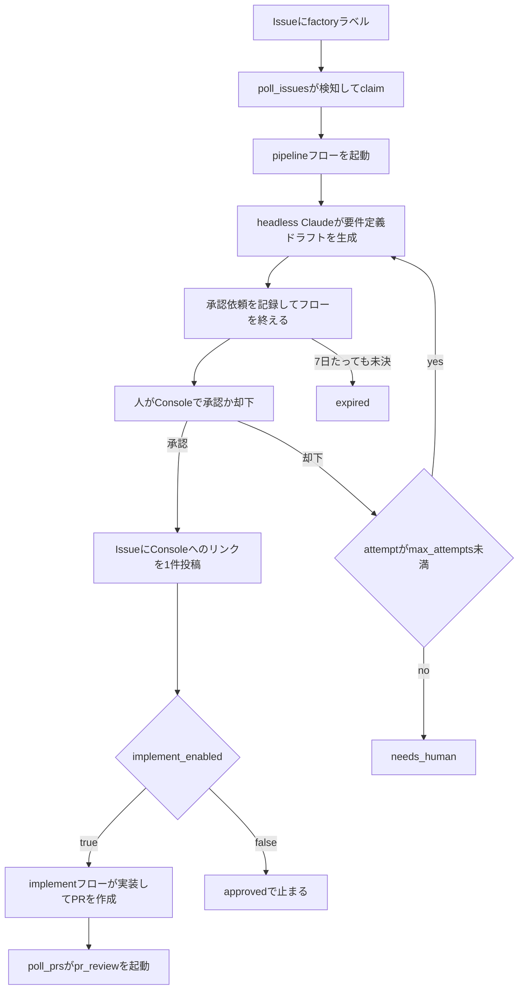
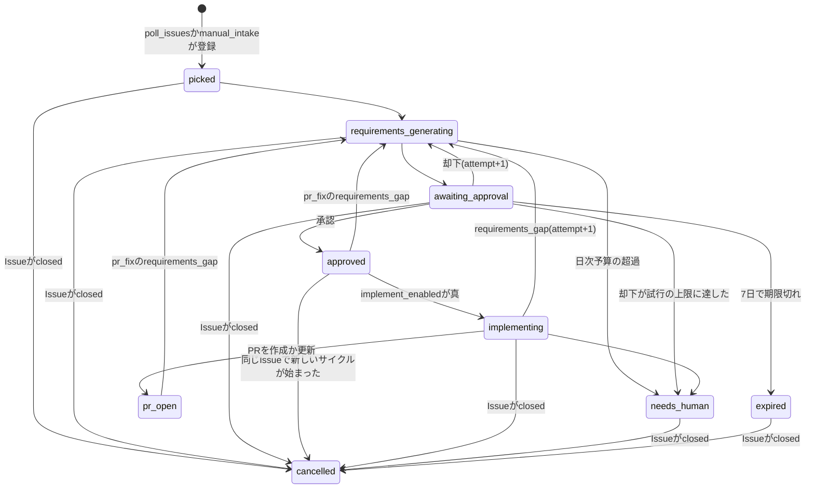
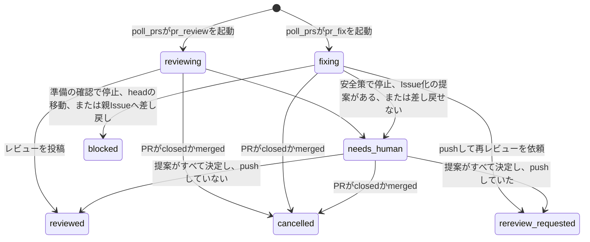
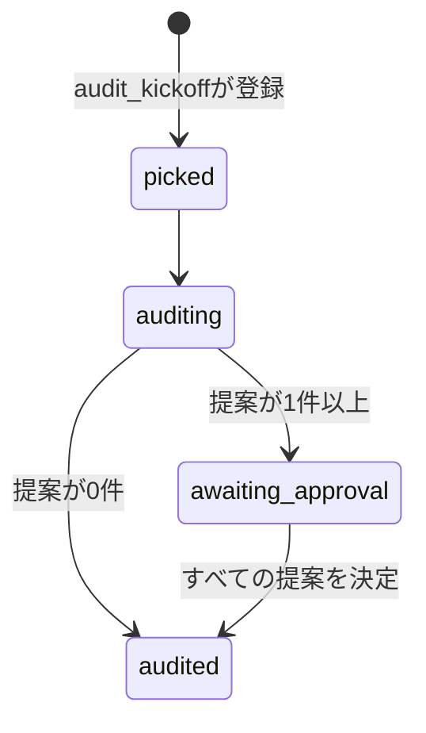

# アーキテクチャ

Software Factoryの構成と、作業がどの順に流れるかを説明する。Factoryを変更する人が、全体の地図として最初に読む文書である。
内部の挙動と設定値は、[作業項目の状態とリース](internals/work-items.md)などの内部仕様の文書に書く。
文書の一覧は[README](../README.md)の「文書」にある。

## 概要

Software FactoryはGitHub Issueを起点に、要件定義から自己改善までをWindmill上のフローで自動化する。入力は`factory`ラベルが付いたIssueと、`factory:review`か`factory:fix`のラベルが付いたPRである。

| コンポーネント | 役割 |
| --- | --- |
| GitHub | Issue、PR、コメントのやり取り先。Factoryはここに成果物だけを書く |
| Windmillのserverとworker | フローとスケジュールの実行基盤 |
| Data Tables | 作業の状態、要件定義ドラフト、承認依頼、実行ログ、失敗記録を持つPostgresのテーブル群 |
| Factory Console | 承認、要件定義書と監査レポートの閲覧、パイプラインの一覧、コストの分析、失敗の再実行、通知の一覧を提供するraw app |
| Console(`console/`) | Vite + Reactで作り直しているConsole。GitHubのCIが組み立てて成果物`console-dist`にし、`console_fetcher`が取り込み、Caddyが`/console/`で配信する |
| Discord | 拾い上げ、承認待ち、承認、要対応、失敗などのイベントをWebhookで通知する |

Claudeを動かすworker(`windmill_worker`)はカスタムイメージで動く。
このイメージには、Claude Code CLI(`claude`)、`gh`、git worktree runner(`gtr`)、`gitleaks`、`wmill`を同梱する。
このworkerはdefaultワーカーグループの1コンテナで、`NUM_WORKERS=3`により3つのワーカープロセスが並列に動く。
メモリの上限はコンテナ全体で4096Mである。

Consoleの問い合わせと操作の受付専用のworkerが、別のコンテナ(`windmill_worker_console`)で動く。
Claudeの長いジョブがdefaultワーカーグループの枠を埋めても、問い合わせと操作の受付を止めないためである。
受け付けたscriptが起動するフローとハンドラは、defaultのworkerで動く。
承認のハンドラ、再実行したpipeline、監査のフローがそうであり、defaultに空きができるまで待つ。
このworkerはワーカーグループ`console`に属し、tag`console`のジョブだけを受ける。
どのscriptをこのworkerで動かすかは、scriptの`tag`で決める。
上流のWindmillイメージで動き、`NUM_WORKERS=2`により2つのワーカープロセスが動く。1件のジョブが止まっても、全体は止まらない。メモリの上限は1024Mである。
`factory_state`と`factory_console`は読み取り専用でマウントし、`factory_workspaces`はマウントしない。

## パイプライン

作業は工程1から工程5の順に進む。工程番号はWindmillの資産のsummaryにも使う(下の命名規則を参照)。

| 工程 | 内容 | 状態 |
| --- | --- | --- |
| 1. 拾う | `factory`ラベル付きのIssueを検知してclaimする | 実装済み |
| 2. 要件定義 | headless Claudeが要件定義ドラフトを生成し、人が承認か却下をする | 実装済み |
| 3. 実装 | 承認済みの要件定義からworktree上で実装し、PRを作る | 実装済み。既定では無効 |
| 3. PRレビュー・修正 | 既存のPRをレビューし、指摘を修正する | 実装済み |
| 4. CI監視 | マージ後のCIを監視する | 未実装 |
| 5. 自己改善 | 運用記録を週次で監査し、レポートと改善提案を作る | 実装済み |

工程3の実装フロー(`implement`)は、`factory_config`の`implement_enabled`を`true`にしたときだけ動く。既定値は`false`で、その間は要件定義を承認した作業項目が承認済み(`approved`)のまま残る。

工程をまたいで、Factory Console、自己更新(`self_update`)、フローとスケジュールの失敗ハンドラが動く。

承認はWindmillのsuspendではなく、承認依頼のテーブルの行で待つ。pipelineフローは承認依頼を記録した時点で終わり、人の決定は別のscriptが反映する。仕組みは[要件定義の生成と承認](internals/requirements.md)に書く。

## 状態遷移

作業項目(`work_items`)の状態は`status`列だけが持つ。GitHubのラベルは人からFactoryへのトリガーに限り、状態を表さない。

### 状態の一覧

作業項目の種別(`kind`)は、Issueの`issue`、PRレビューの`pr_review`、PR修正の`pr_fix`、監査の`audit`の4つである。

| status | 意味 | 種別 | 終端 |
| --- | --- | --- | --- |
| `picked` | claimした直後。監査では作業項目を作った直後 | issue、audit | |
| `requirements_generating` | 要件定義ドラフトを生成している | issue | |
| `awaiting_approval` | 人の承認を待っている | issue、audit | |
| `approved` | 要件定義が承認された | issue | 終端 |
| `rejected` | 値は定義されているが、今のコードは作業項目に書き込まない。却下は承認依頼の状態として記録する | issue | 終端 |
| `implementing` | 実装している。worktree上の実装、検証と修正のループ、PRの作成までを含む | issue | |
| `pr_open` | 実装を終えてPRを作成か更新した。マージ後の追跡は工程4の範囲である | issue | 終端 |
| `reviewing` | PRをレビューしている | pr_review | |
| `reviewed` | レビューをCOMMENTとして投稿した | pr_review、pr_fix | 終端 |
| `fixing` | レビューの指摘やコメントを修正している | pr_fix | |
| `rereview_requested` | 修正をpushし、再レビューを依頼した | pr_fix | 終端 |
| `blocked` | 準備の確認で修正の前に止めた、修正の実行中にPRのheadが動いた、要件の不足で親のIssueへ差し戻した | pr_fix | 終端 |
| `needs_human` | 自動処理を打ち切り、人の対応を待つ | すべて | 終端 |
| `failed` | 実行時エラーで失敗した | すべて | 終端 |
| `expired` | 承認依頼が7日の期限を過ぎた | issue | 終端 |
| `cancelled` | IssueかPRが閉じられた。または、承認済みの要件定義が、同じIssueの新しいサイクルに置き換えられた | すべて | 終端 |
| `auditing` | 監査している | audit | |
| `audited` | 監査を終えた | audit | 終端 |

pr_fixの作業項目は、Issue化の提案がある間は人の対応待ち(`needs_human`)で待つ。提案がすべて決定すると、レビュー済み(`reviewed`)か再レビュー依頼(`rereview_requested`)へ移る。監査の作業項目は、承認待ち(`awaiting_approval`)で提案の決定を待つ。

終端の一覧はコードとDBのviewの2か所にある。そろえ方は[作業項目の状態とリース](internals/work-items.md)に書く。

### Issueの作業項目

### PRの作業項目

### 監査の作業項目

図に描いていない遷移が3つある。
終端でない作業項目は、フローが例外で失敗するか孤児と判定されると失敗(`failed`)になる。
Issueの作業項目とPRの作業項目は、IssueかPRが閉じられると取り消し(`cancelled`)になる。
失敗の作業項目も、IssueかPRが閉じられると取り消しになる。
この取り消しは、図に描いた人の対応待ちと期限切れからの取り消しと同じで、Consoleの要対応の一覧から外すためのものである。
閉じた人が許されるときだけ取り消す。
許されるのは、PRがマージされたとき、作者以外の人が閉じたとき、作者が閉じて作者の関係が許可する関係(`allowed_labeler_associations`)に当たるときである。
Botが閉じたときは取り消さない。

終端の作業項目は、Consoleからの再実行で再び動き出す。遷移の条件、リース、孤児の判定は[作業項目の状態とリース](internals/work-items.md)に書く。

## データモデル

Data Tablesはスキーマ`factory`に置く。migrationは追加だけにし、列やテーブルの名前は変えない。列の定義はmigrationのファイル(`migrations/datatable/main/`)を参照する。

### テーブル

| テーブル | 役割 |
| --- | --- |
| `work_items` | 作業項目1件の状態。`(owner, repo, issue_number, cycle)`で一意 |
| `work_item_events` | 状態遷移の履歴 |
| `requirement_drafts` | 要件定義ドラフト。attemptごとに本文、図の参照、未確定事項、ファイルの置き場所(`doc_dir`)を持つ |
| `approval_requests` | 承認依頼。要件定義の承認とIssue化の提案の承認の両方を持つ |
| `approvals` | 承認と却下の古い履歴。今は書き込まない |
| `agent_runs` | Claudeの実行1回ごとのトークン数、費用、所要時間、終了コード |
| `job_failures` | フローの失敗の記録。トークンはマスクしてから書く |
| `deployments` | 自己更新によるデプロイの結果 |
| `notices` | 人が対応すべき事項。PATの失効やSHAの不一致など。解決した人と時刻(`resolved_by`、`resolved_at`)も持ち、DBの掃除が解決した行の`resolved_by`は`cleanup_db`になる |
| `reviews` | pr_reviewの実行1回ごとの判定、総評、指摘、投稿したレビューのID |
| `fix_rounds` | pr_fixの実行1回ごとの結果、返信、コミット |
| `implement_rounds` | 実装フローのClaude実行1ラウンドごとの記録 |
| `issue_proposals` | Issue化の提案の題名と本文、決定の履歴 |
| `audit_reports` | 監査1回のレポート。作業項目と1対1に対応する |
| `cleanup_runs` | DBの掃除1回ごとの削除件数 |

`work_items`の列は種別によって使うものが違う。実装ブランチ(`branch`)と作成したPRのURL(`pr_url`)はIssueの作業項目だけが持ち、PR番号(`pr_number`)はPRの作業項目だけが持つ。PR番号をIssueの作業項目に入れないのは、PRの作業項目の束ね方がこの列で決まるためである。実装ブランチの名前は`factory/issue-<N>-wi-<id>`である。

`agent_runs`には、Claudeの不正な出力を再試行したときに捨てた最初の試行も、同じattemptの別の行として記録する。費用が分かるときは、その費用も日次予算の集計とコストの分析に含める。出力がJSONとして読めないときは費用が分からない。

`implement_rounds`の主な列は次のとおり。行は作業項目の削除にあわせて消える。

| 列 | 内容 |
| --- | --- |
| `round` | 作業項目の中の連番。`(work_item_id, round)`で一意 |
| `mode` | `implement`か`fix` |
| `outcome` | `done`、`requirements_gap`、`check_failed`、`checks_skipped`、`stalled`、`error`のいずれか |
| `check_output` | 検査の出力の先頭16KB |
| `protected_changes` | 保護パスの変更の一覧(jsonb) |
| `diff_stat` | 差分の量。`{files, added, deleted}`の形のjsonb |

ほかに`summary`、`gap_report`、`checks_skipped_reason`、`agent_run_id`を持つ。

`issue_proposals`は提案の題名、本文、レビューコメントのID、スレッドのIDを持つ唯一の場所で、`approval_requests`はこれらを複製しない。提案の出どころ(`origin`)は`pr_fix`か`audit`である。監査の提案は`audit_report_id`と`position`でレポートに結びつき、レビューコメントのIDは持たない。

`audit_reports`は本文を`markdown`列に持ち、証跡の数値を`metrics`列に持つ。

### view

Consoleの一覧と集計は次のviewを読む。

| view | 内容 |
| --- | --- |
| `v_inbox` | 承認タブの一覧 |
| `v_pipeline` | パイプラインの一覧 |
| `v_agent_cost_daily` | Claudeの実行の日ごとの費用 |
| `v_approval_stats` | 承認と却下の集計 |
| `v_lead_time` | 作業項目が終端になるまでの時間 |
| `v_failures` | 失敗の一覧 |
| `v_notices` | 要対応事項の一覧 |
| `v_issue_proposals` | Issue化の提案の一覧 |
| `v_approval_requests` | 承認依頼の一覧 |
| `v_audit_reports` | 監査レポートの一覧 |
| `v_reviews` | PRレビューの一覧 |
| `v_fix_rounds` | PR修正の一覧 |

要件定義書と監査レポートの詳細表示では、Consoleのbackend(`f/factory/steps/console_query.ts`)がテーブルを直接読む。読むのは`requirement_drafts`、`audit_reports`、`approval_requests`、`issue_proposals`、`work_items`である。

`console_query`は、行の配列を返すviewのほかに、1つのオブジェクトを返す3つのviewを持つ。

| view | 内容 |
| --- | --- |
| `summary` | サイドバーの件数と、要対応の一覧。承認待ち、作業項目の失敗、要対応の通知を返す |
| `work_item_detail` | 作業項目1件の概要、要件定義の試行、承認の履歴、実装のラウンド、失敗。PRの作業項目では、レビューと修正の一覧(件数だけ)も返す。検査コマンドの出力は返さない |
| `system_status` | 反映の状態、Consoleの取り込みの状態、作業項目の無い失敗、情報の通知、解決済みの通知 |

次の6つのscriptは、tag `console`を付け、Console用のworkerで動かす。

- `console_query`
- `approval_decide`
- `retry_work_item`
- `audit_kickoff`
- `notice_resolve`
- `console_fetch_watch`

どれも、Claudeの長いジョブがdefaultのworkerの枠を埋めても、Consoleを止めないためである。

## フローとスケジュール

### フロー

| フロー | 起動元 | 内容 |
| --- | --- | --- |
| `manual_intake` | 人がフォームから実行 | 入力からIssueを作り、作業項目を登録してpipelineを起動する |
| `pipeline` | `poll_issues`、`manual_intake`、再実行、差し戻し | 要件定義ドラフトを生成し、承認依頼を記録する |
| `implement` | 要件定義の承認、再実行 | 承認済みの要件定義から実装し、検証と修正を繰り返し、PRを作る |
| `pr_review` | `poll_prs`、再実行 | PRをレビューし、COMMENTとして投稿する |
| `pr_fix` | `poll_prs`、再実行 | 指摘を修正してpushし、各コメントに返信して再レビューを依頼する |
| `audit` | `audit_kickoff` | 証跡を集め、監査レポートと改善提案を生成し、提案の承認依頼を登録する |

承認、却下、期限切れの分岐はフローの外にある。人の決定は`approval_decide`が記録し、期限切れは`poll_issues`が判定する。

フローが失敗すると、各フローの失敗時のステップ(`failure_module`)が`on_error_flow`を呼ぶ。`on_error_flow`は失敗を`job_failures`に記録し、作業項目を失敗にして、Discordに通知する。IssueやPRには何も書かず、ラベルにも触れない。

### スケジュール

<!-- generated:schedules -->
| スケジュール | cron(秒 分 時 日 月 曜日) | 実行するもの | 内容 |
| --- | --- | --- | --- |
| audit_kickoff | `0 30 9 * * 1` | `f/factory/audit_kickoff` | 毎週月曜09:30(Asia/Tokyo)に実行します。前回の監査レポート以降の運用記録(失敗・却下・要人手・コスト・通知・デプロイ)に行動につながる記録があれば、監査の作業項目を作成して監査フローを起動します。記録が無い場合、別の監査が実行中の場合、日次予算を超過している場合は何もしません。 |
| cleanup_db | `0 30 3 * * *` | `f/factory/cleanup_db` | 毎日3:30に実行します。終端状態(承認済み・却下・要対応・タイムアウト・失敗・レビュー済み・再レビュー依頼・ブロック・キャンセル・PR作成済み・監査完了)になった作業項目を既定90日(`factory_config`の`retention_work_items_days`で変更可)で削除し、あわせて要件定義ドラフトや承認依頼などの関連データも削除します。失敗記録・デプロイ記録・解決済みのお知らせは既定30日(`retention_logs_days`)で個別に削除します。古い「情報」の未解決のお知らせは、削除せず同じ期間で解決済みにします。 |
| cleanup_workspaces | `0 0 3 * * *` | `f/factory/cleanup_workspaces` | 毎日3:00に実行します。処理が終わった作業用ディレクトリや、動かなくなった処理の後始末を行い、保存領域の使用量を記録します。 |
| console_fetch_watch | `0 */10 * * * *` | `f/factory/console_fetch_watch` | 10分ごとに実行します。Consoleの取り込み(console_fetcher)が書く状態を読み、失敗、更新の停止、状態が読めないことを、通知に残し、新しく残したときだけDiscordに知らせます。rate limitなどの一時的な失敗は、60分以上続いたときだけ知らせます。正常に戻っても通知は自動では解決しません。 |
| notify_daily_summary | `0 0 9 * * *` | `f/factory/notify_daily_summary` | 毎日9:00(Asia/Tokyo)に実行します。前日分の実行回数・コスト・失敗回数と承認/却下の件数を集計し、Discordへ日次サマリを投稿します。 |
| poll_issues | `0 */5 * * * *` | `f/factory/poll_issues` | 5分ごとに実行します。稼働確認とデプロイ状況の通知を行い、担当リポジトリのIssueを検索して担当を確定します。あわせて、進行中のすべての作業項目をGitHub側の状態と突き合わせ、後始末が必要なものを処理します。失敗、人の対応待ち、期限切れの作業項目は、対象のIssueやPRが閉じられていれば取り消して、要対応の一覧から外します。 |
| poll_prs | `0 */5 * * * *` | `f/factory/poll_prs` | 5分ごとに実行します。PRにレビュー依頼のラベルが付いている、レビューをリクエストされている、または担当者(assignee)に指定されている場合はレビュー処理を開始します。修正依頼のラベルが付いている場合は修正処理を開始します。作業項目の後始末はIssueの巡回処理側で行います。 |
| self_update | `0 */10 * * * *` | `f/factory/self_update` | 10分ごとに実行します。Software Factory自身の最新のコミットを取り込み、変更があればWindmillへの反映とデータベースの更新を自動的に行います。ホスト側の変更は次にホストで起動したときに反映されるため、通知はしません。更新の最後に、Console用のworkerが止まっていないかを確かめ、止まっていれば通知を残してDiscordにも知らせます。 |
<!-- /generated:schedules -->

cronはWindmillの6フィールドの形式で、タイムゾーンは`Asia/Tokyo`である。各スケジュールは`no_flow_overlap: true`を持ち、前回の実行が終わっていなければその回を飛ばす。スケジュールの失敗は`on_error_schedule`が記録して通知する。

生成した表の内容欄より細かい処理の対象は次のとおり。

| スケジュール | 処理の対象 |
| --- | --- |
| `poll_issues` | Issueの検知とclaim、作業項目の照合(reconcile)、再投入の検出、承認依頼の期限切れ。照合ではIssueとPRのclose、孤児になったジョブを見つける。閉じたIssueやPRの失敗、人の対応待ち、期限切れの作業項目は、閉じた人を確かめて取り消し、要対応の一覧から外す |
| `cleanup_workspaces` | 期限を過ぎたworktree(`req-<N>`、実装ブランチのworktree、`review-*`、pr_fixのgtrのworktree)、worktreeが無くなったプロセスのロックファイル、孤児になったheadless Claudeのプロセス。生き残りのプロセスが使っているworktreeは消さず、noticeを残す。ディスクの使用量も記録する |
| `console_fetch_watch` | Consoleの取り込みが共有ボリュームに書く状態(`status.json`)。原因を最初に見た時刻をWindmillのstateに残し、一時的な失敗が続いた長さを測る。重複は通知の側で防ぐ |
| `notify_daily_summary` | 前日のコスト、件数、失敗、DBの掃除の件数 |

複数のインスタンスを同時に動かすときの排他は、GitHub側のclaimで取る。
Issueはassigneeを追加してからトリガーラベルを外し、外す要求に成功したインスタンスが受け持つ。
PRも同じくトリガーラベルの削除で所有を決め、削除が404なら引く。
外せた後は取り直して残っていないかを確かめる。
この排他はベストエフォートである。
最後の防御は、`work_items`の部分一意インデックス`work_items_active_issue_key`である。
終端でないIssueの作業項目は、`owner`、`repo`、Issueの番号の組ごとに、同時に1つしか持てない。
これはDBを共有するインスタンスの間で働き、DBを分けたインスタンスが同じリポジトリを扱う構成は対象外である。
1つのリポジトリは1つのインスタンスだけで扱う。

## 命名規則

WindmillのUIはsummaryの順に並ぶので、summaryの先頭に種別のタグを付ける。pathは英数字だけにし、一度決めたら変えない。

| タグの形式 | 対象 |
| --- | --- |
| `[SF-<工程>-<順>] <日本語の表示名>` | 自動で動くフローとスケジュール |
| `[SF-<工程>-<順>/<n>] <日本語>` | フローの中のステップのscript |
| `[OP-<工程>-<順>] <日本語>` | 人がUIから手動で実行するもの |
| `[SYS-<順>] <日本語>` | 基盤と運用の自動処理 |
| `[LIB] <日本語>` | 共有ライブラリ |

工程番号は、1が作業を拾う、2が要件定義、3が実装とPR、4がCI監視、5が自己改善である。Consoleは工程0として扱う。

### 資産の一覧

<!-- generated:assets -->
| path | 種別 | summary |
| --- | --- | --- |
| `f/factory/lib/console_status` | script | [LIB] Consoleの取り込みの状態 |
| `f/factory/lib/console_support` | script | [LIB] Consoleの通知の重要度 |
| `f/factory/lib/console_worker` | script | [LIB] Console用workerの停止の検知 |
| `f/factory/lib/db` | script | [LIB] Data Tableアクセス |
| `f/factory/lib/cleanup_db_support` | script | [LIB] DB掃除の純粋ロジック |
| `f/factory/lib/discord` | script | [LIB] Discord通知 |
| `f/factory/lib/drawio` | script | [LIB] draw.io図の生成 |
| `f/factory/lib/workspace` | script | [LIB] git worktreeと作業領域 |
| `f/factory/lib/github` | script | [LIB] GitHub APIラッパー |
| `f/factory/lib/claude` | script | [LIB] headless Claude実行 |
| `f/factory/lib/claim_support` | script | [LIB] Issue取得の後処理 |
| `f/factory/steps/pr_workflow_support` | script | [LIB] PRワークフロー共通処理 |
| `f/factory/lib/process_lock` | script | [LIB] worktree単位のプロセス排他 |
| `f/factory/lib/prompts` | script | [LIB] プロンプト定義 |
| `f/factory/lib/log` | script | [LIB] ログとマスク |
| `f/factory/lib/cleanup_support` | script | [LIB] 作業領域掃除の純粋ロジック |
| `f/factory/lib/protected_paths` | script | [LIB] 保護パスの判定 |
| `f/factory/lib/types` | script | [LIB] 共通型 |
| `f/factory/lib/implement_finish_support` | script | [LIB] 実装フローの完了処理の判定 |
| `f/factory/lib/implement_loop` | script | [LIB] 実装フローの検証ループ |
| `f/factory/lib/implement_support` | script | [LIB] 実装フローの純粋関数群 |
| `f/factory/lib/implement_launch_support` | script | [LIB] 実装フローの起動判定 |
| `f/factory/lib/supersede_support` | script | [LIB] 承認の取り消しのコメント |
| `f/factory/lib/approval_support` | script | [LIB] 承認依頼の純粋ロジック |
| `f/factory/lib/approver` | script | [LIB] 承認者の導出 |
| `f/factory/lib/prose_check` | script | [LIB] 文章の検査 |
| `f/factory/lib/summary_support` | script | [LIB] 日次サマリの集計 |
| `f/factory/lib/audit_support` | script | [LIB] 監査の期間計算と起動判定 |
| `f/factory/lib/audit_evidence` | script | [LIB] 監査の証跡収集 |
| `f/factory/lib/audit_doc` | script | [LIB] 監査レポートの検査 |
| `f/factory/lib/schedule_failing` | script | [LIB] 続けて失敗するスケジュールの検知 |
| `f/factory/lib/self_update_support` | script | [LIB] 自己更新の純粋ロジック |
| `f/factory/lib/requirements_template` | script | [LIB] 要件定義テンプレートの定義 |
| `f/factory/lib/requirements_doc` | script | [LIB] 要件定義ファイルの検査 |
| `f/factory/lib/pipeline_lease` | script | [LIB] 要件定義フローのリース判定 |
| `f/factory/lib/config` | script | [LIB] 設定の読み込み |
| `f/factory/lib/poll_support` | script | [LIB] 巡回の純粋ロジック |
| `f/factory/factory_console` | app | [OP-0-1] Factory Console(承認・進捗・分析) |
| `f/factory/steps/console_query` | script | [OP-0-1/1] Console用データ取得 |
| `f/factory/manual_intake` | flow | [OP-1-1] 手動投入フォーム(Issueを作成して工程に乗せる) |
| `f/factory/steps/manual_intake_create_issue` | script | [OP-1-1/1] Issueを作成 |
| `f/factory/steps/manual_intake_register` | script | [OP-1-1/2] 作業項目を登録して工程2を起動 |
| `f/factory/approval_decide` | script | [OP-2-1] 承認 / 差し戻しを記録して反映 |
| `f/factory/retry_work_item` | script | [OP-2-2] 作業項目を再実行 |
| `f/factory/notice_resolve` | script | [OP-2-3] 通知を解決 |
| `f/factory/poll_issues` | script | [SF-1-1] Issueを巡回して担当を確定 |
| `f/factory/poll_prs` | script | [SF-1-2] PRを巡回してレビュー / 修正を起動 |
| `f/factory/pipeline` | flow | [SF-2-1] 要件定義の生成と承認 |
| `f/factory/steps/pipeline_prepare` | script | [SF-2-1/1] 作業領域の準備 |
| `f/factory/steps/pipeline_generate` | script | [SF-2-1/2] 要件定義の生成(Claude) |
| `f/factory/steps/pipeline_request_approval` | script | [SF-2-1/3] 承認依頼 |
| `f/factory/steps/requirements_apply` | script | [SF-2-2] 要件定義の承認結果を反映 |
| `f/factory/pr_review` | flow | [SF-3-1] PRの自動レビュー |
| `f/factory/steps/pr_review_prepare` | script | [SF-3-1/1] PRの取得と検証 |
| `f/factory/steps/pr_review_generate` | script | [SF-3-1/2] レビューの生成(Claude) |
| `f/factory/steps/pr_review_post` | script | [SF-3-1/3] レビューの投稿 |
| `f/factory/pr_fix` | flow | [SF-3-2] レビュー指摘の修正と再レビュー依頼 |
| `f/factory/steps/pr_fix_prepare` | script | [SF-3-2/1] worktreeの準備と安全確認 |
| `f/factory/steps/pr_fix_collect` | script | [SF-3-2/2] 指摘の収集 |
| `f/factory/steps/pr_fix_apply` | script | [SF-3-2/3] 修正の適用(Claude) |
| `f/factory/steps/pr_fix_verify` | script | [SF-3-2/4] 変更の検証 |
| `f/factory/steps/pr_fix_finish` | script | [SF-3-2/5] pushと再レビュー依頼 |
| `f/factory/steps/issue_proposal_apply` | script | [SF-3-3] Issue化提案の承認結果を反映 |
| `f/factory/implement` | flow | [SF-3-4] 実装とPR作成 |
| `f/factory/steps/implement_prepare` | script | [SF-3-4/1] 作業領域の準備 |
| `f/factory/steps/implement_generate` | script | [SF-3-4/2] 実装(Claude) |
| `f/factory/steps/implement_verify` | script | [SF-3-4/3] 検証と修正のループ |
| `f/factory/steps/implement_finish` | script | [SF-3-4/4] コミット・push・PR作成 |
| `f/factory/audit_kickoff` | script | [SF-5-1] 週次監査の起動 |
| `f/factory/audit` | flow | [SF-5-2] 運用記録の監査と改善提案 |
| `f/factory/steps/audit_prepare` | script | [SF-5-2/1] 証跡の収集と作業領域の準備 |
| `f/factory/steps/audit_generate` | script | [SF-5-2/2] 監査レポートと提案の生成(Claude) |
| `f/factory/self_update` | script | [SYS-1] Software Factory自身を最新化 |
| `f/factory/cleanup_workspaces` | script | [SYS-2] 作業領域を掃除 |
| `f/factory/notify_daily_summary` | script | [SYS-3] 日次サマリ通知 |
| `f/factory/on_error_flow` | script | [SYS-4] フロー失敗ハンドラ |
| `f/factory/on_error_schedule` | script | [SYS-5] schedule失敗ハンドラ |
| `f/factory/cleanup_db` | script | [SYS-6] DBを掃除 |
| `f/factory/console_fetch_watch` | script | [SYS-7] Consoleの取り込みを見張る |
<!-- /generated:assets -->

## PRワークフロー

工程1から工程2のIssueの流れとは別に、既存のPRをレビューし修正するワークフローがある。対象は人が作ったPRと、実装フローが作ったPRである。

| ワークフロー | 起動の条件 | 終わり方 |
| --- | --- | --- |
| PRレビュー(`pr_review`) | `factory:review`ラベルが付く。または、このインスタンスのアカウントがレビューを依頼されているかassigneeで、未処理のcommitがある | レビューを常にCOMMENTとして投稿し、レビュー済みになる |
| PR修正(`pr_fix`) | `factory:fix`ラベルが付く | 修正をpushし、各コメントに返信して再レビューを依頼する |

PR修正への指示は、ラベルを付ける前にPRへ通常のコメントとして書く。PR修正は、ほかの人のコメントと同じくそのコメントを指摘として集める。

要件の変更が必要なとき、PR修正は要件や設計を書き換えずに中断する。元のIssueの作業項目(`parent_work_item_id`で結びつく)を、試行回数を1つ増やして要件定義に戻す。

PRに書くのは、レビューの指摘と総評、修正の返信だけである。失敗、要対応、ブロック、差し戻しといった運用上の出来事はDiscordに通知する。

作業ディレクトリは次のとおり使い分ける。`/workspaces/<owner>/<repo>/main`はfetch専用で、working treeをcheckoutしない。

| ワークフロー | worktree |
| --- | --- |
| PRレビュー | `/workspaces/<owner>/<repo>/review-<pr>-<sha7>`にPRのcommitをdetachedで置き、終わったら消す |
| PR修正 | `git gtr new`で作るPRブランチのworktree |

Factoryの投稿の見分け方、総評の組み立て、スレッドの解決、Issue化の提案、処理済みの位置(watermark)は[PRワークフローの内部仕様](internals/pr-workflow.md)に書く。安全策は[セキュリティ](security.md)に書く。

## 自己更新

`self_update`はFactory自身のリポジトリを10分ごとに取り込み、Windmillに反映する。

1. worker内のself clone(`/workspaces/factory/atelier-works`)をpullする。HEADのSHAがWindmill変数`f/factory/deployed_sha`と同じなら何もしない。
2. 変わっていれば、Consoleのraw appの依存を`npm ci --ignore-scripts`でそろえる。依存のinstall scriptは動かさない。
3. workerの中から`wmill sync push --yes --keep-deleted`を実行し、script、flow、スケジュールを最新にする。
4. `wmill datatable migrate up`を実行し、Data Tableの定義を最新にする。
5. 結果を`deployments`に記録し、`f/factory/deployed_sha`を更新する。

`infra/**`の変更と、`mise.toml`の`[tools]`か`[env]`の変更は、worker自身では反映できない。`self_update`は`deployments.needs_host_action`を`true`にしてログに残し、通知はしない。これらはホスト側のcheckoutをpullしたうえで、次に`mise run up`で起動したときに反映される。

`console/`の変更は`self_update`の対象ではない。
マージ後にCIが成果物`console-dist`を作り、`console_fetcher`が数分で取り込む。
`classifyChangedPaths`は`console/`の変更を`console_paths`として分けて返し、実装フローはPR本文の「Windmillへの反映」に印を付ける。
仕組みは[Consoleの仕様](internals/console.md)に書く。

Claudeに渡すスキル(`.claude/skills/**`)は、実行のたびにself cloneから読む。そのためpullの直後の実行から反映される。初回の反映(スケジュールの登録と最初のpush)は、ホストから`scripts/bootstrap.sh`が行う。

## 工程5の監査

`audit_kickoff`が毎週月曜09:30に、前回の監査以降の運用記録を確かめる。行動につながる記録があれば、監査の作業項目を作って`audit`フローを起動する。Consoleの監査タブの**今すぐ監査**からも起動できる。

`audit`フローは、証跡をまとめた資料(証跡パック)を作り、headless Claudeに監査レポートと改善提案を書かせる。提案は人が承認したものだけが、Factory自身のリポジトリ(`factory_repo`)にIssueとして起票される。起動の条件、期間、検査は[監査の内部仕様](internals/audit.md)に書く。

## 未実装の機能

- 工程4のマージ後のCIの監視
- Discordのボタンによる承認(Interactions Endpointに公開URLが要る)

工程3の実装フローの内部は[実装フローの内部仕様](internals/implement.md)に書く。
