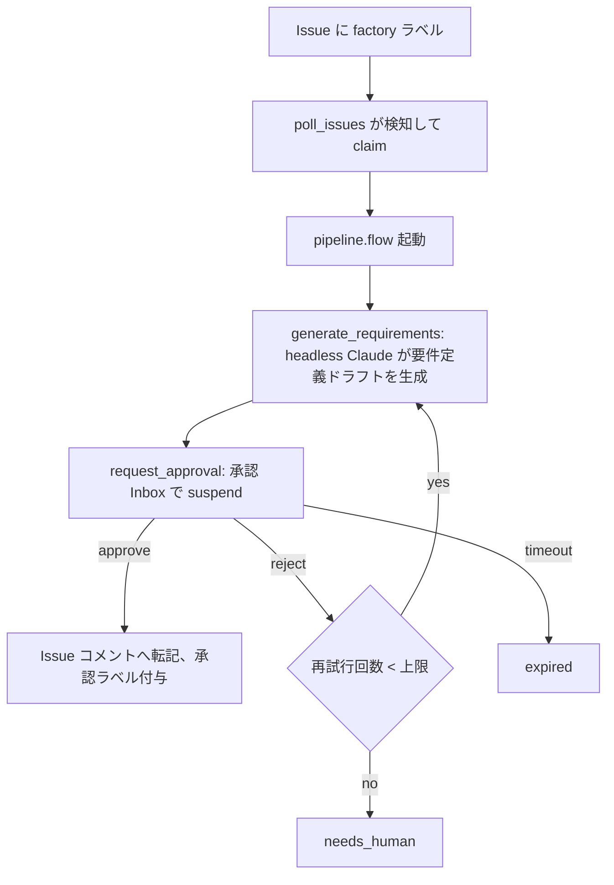
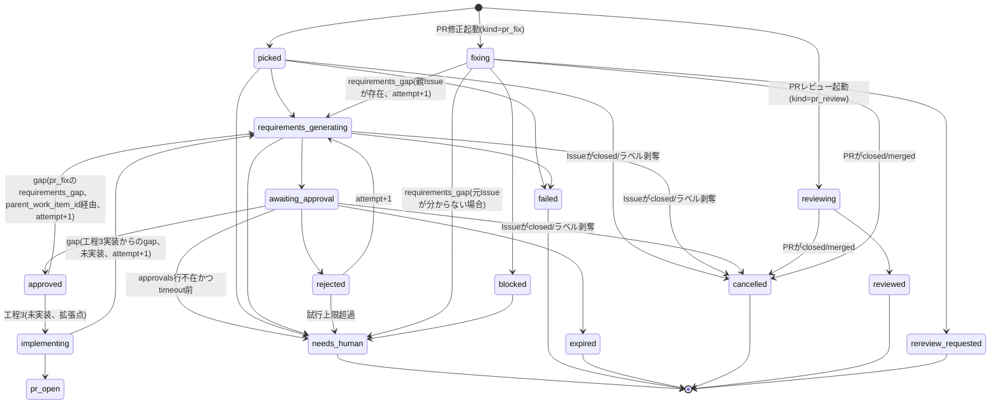

# アーキテクチャ

## 概要

Software Factory は GitHub Issue を起点に、要件定義から自己改善までを Windmill 上のフローとして自動化する仕組みである。

主なコンポーネント:

- **GitHub**: Issue の起票・ラベル付け・PR・コメントのやり取り先。`factory` ラベルが付いた Issue が入力になる。
- **Windmill server / worker**: フローとスケジュールの実行基盤。worker はカスタムイメージで動き、`claude`(Claude Code CLI)、`gh`、`gtr`(git worktree runner)、`wmill` を同梱する。worker は default ワーカーグループの 1 コンテナで、`NUM_WORKERS=3` により内部で 3 つのワーカープロセスが並列動作する(メモリ上限は 1 コンテナ分の 4096M のまま)。
- **Data Tables**: 作業の状態・要件定義ドラフト・承認履歴・実行ログ・失敗記録などを保持する Postgres ベースのテーブル群。
- **App(ダッシュボード)**: 承認 Inbox、パイプラインの一覧、コスト等の分析、失敗の再実行、通知一覧を提供する UI。
- **Discord**: 各イベント(拾い上げ、承認待ち、承認、却下、要対応、失敗など)を Webhook 経由で通知する。

## パイプライン(工程 1 → 5)

実装済みは工程 1(作業を拾う)、工程 2(要件定義の生成と承認・差し戻し)、工程 3 の一部(PR レビュー・修正)、
ダッシュボード(Factory Console)、自己更新と失敗ハンドラ。工程 3 の「Issue から実装して PR を作る」、
工程 4・5 は拡張点として後続で実装予定。

| 工程 | 内容 | 状態 |
| --- | --- | --- |
| 1. 拾う | `factory` ラベル付き Issue を検知して claim する | 実装済み |
| 2. 要件定義 | headless Claude が要件定義ドラフトを生成し、人が承認・差し戻しする | 実装済み |
| 3. 実装 | worktree 上で実装し PR を作成する | 未実装(拡張点) |
| 3. PR レビュー・修正 | 既存 PR をレビュー・修正する(`pr_review` / `pr_fix`) | 実装済み |
| 4. CI 監視 | マージ後の CI を監視する | 未実装(拡張点) |
| 5. 自己改善 | 失敗や却下の履歴から改善提案を Issue 化する | 未実装(拡張点) |

`request_approval` は Windmill の suspend ステップで待機する。resume URL に POST した本文は後続ステップには渡らない(suspend ステップの戻り値は `{resume, cancel, approvalPage}` のみ)ため、`approval_decide` は resume する前に承認内容(decision / reason / approver)を先に `approvals` テーブルへ記録し、resume 後の分岐ステップは `approvals` の最新行(`work_item_id` + `attempt` 単位)を読んで approve / reject を判断する。タイムアウトは `approvals` に対応する行が無いことで判別する。

## 状態遷移(work_items.status)

### status 一覧

| status | 意味 | 工程 |
| --- | --- | --- |
| `picked` | Issue を claim した直後 | 1 |
| `requirements_generating` | 要件定義ドラフトを生成中 | 2 |
| `awaiting_approval` | 承認 Inbox で承認待ち | 2 |
| `approved` | 要件定義が承認された | 2 |
| `rejected` | 却下され再生成待ち(attempt+1) | 2 |
| `needs_human` | 自動処理を打ち切り人の対応が必要(試行上限超過、unsupported channel、requirements_gap の元 Issue 不在、等) | 2/PR ワークフロー |
| `failed` | 実行時エラーで失敗 | 1/2 |
| `expired` | 承認タイムアウト(7 日) | 2 |
| `cancelled` | Issue が closed またはラベル剥奪 | 1/2 |
| `implementing` | 実装中(worktree 上で実装 → レビュー → PR 作成) | 3(未実装、拡張点) |
| `pr_open` | 実装が完了し PR を作成した | 3(未実装、拡張点) |
| `reviewing` | PR レビューを実行中(`kind=pr_review`) | PR ワークフロー |
| `reviewed` | PR レビューを COMMENT として投稿済み(終端、`kind=pr_review`) | PR ワークフロー |
| `fixing` | レビュー指摘・コメントの修正を実行中(`kind=pr_fix`) | PR ワークフロー |
| `rereview_requested` | 修正を push し再レビューを依頼した(終端、`kind=pr_fix`) | PR ワークフロー |
| `blocked` | 禁止された変更パターンの検出、差分上限超過、または安全策の前提が崩れて中断(`kind=pr_fix`) | PR ワークフロー |

work item を終端 status(`approved` / `needs_human` / `expired` / `failed` / `reviewed` / `rereview_requested` / `blocked` / `cancelled`)にする際は、`wip` ラベルに加えてトリガーラベル(Issue の `factory`、PR の `factory:review` / `factory:fix`)も外す(`approved` は `factory` の代わりに `factory:approved` へ付け替える)。トリガーラベルを残すと、孤児失敗した Issue / PR が次回の poll で自動再クレームされ、無限に再試行してしまう。人が改めてラベルを付け直したときだけ新しいサイクル・再実行が始まる。

`retry_work_item` のように終端 status から再度フローを起動する経路は、逆に `runFlowAsync` の前に同じ wip + トリガーラベル(kind に応じて `factory` / `factory:review` / `factory:fix`)を冪等に再付与する。付け忘れると、再起動直後の work item がラベル無しのまま `poll_issues` の reconcile(5 分周期)に「トリガーラベル剥奪」と誤認され、即座に再度 `cancelled` にされてしまう。terminal 化する経路を新設・変更するときは、対になる再起動経路がラベルを再付与しているかを必ず確認する。

### 状態遷移の詳細

**工程 2 (要件定義) から工程 3 へ:**
- `approved` → `implementing`(工程 3 実装ステップで実装を試みる)。
- `implementing` → `requirements_generating: gap`(工程 3 実装ステップが `requirements_gap` を返した場合、attempt+1 で要件定義を再生成。状態遷移図では省略)。

**PR ワークフローの `requirements_gap`:**
- `pr_fix` フロー実行中に `outcome: "requirements_gap"` が返された場合、`parent_work_item_id` で元 Issue の work item を特定する。
- 元 Issue が存在する場合、その work item を `requirements_generating` に attempt+1 で再起動(issue の工程 2 に戻す)。
- 元 Issue が見つからない場合(PR が factory 製ではなく manual で投入された場合など)は `needs_human` に遷移。

**unsupported channel:**
- `awaiting_approval` 状態中に、approval page URL から直接 resume された場合(approval data がスキップされた場合)、approvals テーブルに対応する行が無い状態で timeout 判定が走り、`needs_human` に遷移。

## データモデル

Data Tables はスキーマ `factory` に置く。migration は追加のみで、rename は禁止する(列定義の詳細は migration ファイル自体を正とする)。

### テーブル

| テーブル | 役割 |
| --- | --- |
| `work_items` | Issue 単位の作業状態。`(owner, repo, issue_number, cycle)` で一意 |
| `work_item_events` | 状態遷移のイベント履歴 |
| `requirement_drafts` | 要件定義ドラフト(markdown、図、未確定事項)。attempt ごとに保存 |
| `approvals` | 承認・却下の判断履歴 |
| `agent_runs` | Claude 実行 1 回ごとのログ(トークン数、コスト、所要時間、終了コード等) |
| `job_failures` | フロー実行時のエラー(トークンはマスク済み) |
| `deployments` | self_update によるデプロイ結果 |
| `notices` | 要対応事項(ホスト操作要、PAT 失効、SHA 不一致など) |

### view(App はこれらのみを参照する)

`v_inbox`、`v_pipeline`、`v_agent_cost_daily`、`v_approval_stats`、`v_lead_time`、`v_failures`、`v_notices`

## フローとスケジュール

| 名称 | 種別 | 概要 |
| --- | --- | --- |
| `poll_issues` | schedule(5 分毎) | Issue の検知・claim・reconcile(closed 検知、孤児ジョブ検知)・再投入検出 |
| `manual_intake` | flow(フォーム起動) | フォーム入力から Issue を作成し同じパイプラインに乗せる |
| `pipeline` | flow | 要件定義生成 → 承認 suspend → 承認/却下/タイムアウトの分岐 → 通知 |
| `self_update` | schedule(10 分毎) | self clone を pull し、変更があれば `wmill sync push` と migration を適用する |
| `cleanup_workspaces` | schedule(毎日 03:00) | 期限切れ worktree の削除、古い transcript の削除 |
| `daily_summary` | schedule(毎日 09:00) | 前日のコスト・件数・失敗を Discord に通知 |

各 schedule の cron はタイムゾーン `Asia/Tokyo`、Windmill の 6 フィールド形式で `*.schedule.yaml` に持つ。多重実行防止は advisory lock を使わず、各 schedule の `no_flow_overlap: true` で行う(前回実行中はスキップする)。複数インスタンスを同時運用する場合の排他は Windmill 側ではなく GitHub 側の claim(`wip` ラベル + assignee)で担保する。error handler で失敗を記録し、すべてのフロー（pipeline / pr_review / pr_fix）の `failed` 終端処理（ラベル除去、Issue / PR コメント、Discord 通知）は `on_error_flow` に一本化される。承認のタイムアウト(7 日)は schedule ではなく `pipeline` の suspend 設定側が持つ。

## 命名規則

Windmill の UI は summary でソートされるため、種別を示すタグを summary の先頭に付ける(path は英数字のみに固定し変更しない)。

| タグ形式 | 対象 |
| --- | --- |
| `[SF-<工程>-<順>] <日本語の表示名>` | 自動フロー / schedule |
| `[SF-<工程>-<順>/<n>] <日本語>` | フロー内ステップ script |
| `[OP-<工程>-<順>] <日本語>` | 人が UI から手動実行するもの |
| `[SYS-<順>] <日本語>` | 基盤・運用の自動処理 |
| `[LIB] <日本語>` | 共有ライブラリ |

工程番号は 1=作業を拾う、2=要件定義、3=実装・PR、4=CI 監視、5=自己改善に対応する。

### 割り当て表

| path | summary |
| --- | --- |
| `f/factory/poll_issues`(script + schedule) | `[SF-1-1] Issue を巡回して担当を確定` |
| `f/factory/poll_prs`(script + schedule) | `[SF-1-2] PR を巡回してレビュー / 修正を起動` |
| `f/factory/manual_intake__flow` | `[OP-1-1] 手動投入フォーム(Issue を作成して工程に乗せる)` |
| `f/factory/steps/manual_intake_create_issue` | `[OP-1-1/1] Issue を作成` |
| `f/factory/steps/manual_intake_register` | `[OP-1-1/2] 作業項目を登録して工程 2 を起動` |
| `f/factory/pipeline__flow` | `[SF-2-1] 要件定義の生成と承認` |
| `f/factory/steps/pipeline_prepare` | `[SF-2-1/1] 作業領域の準備` |
| `f/factory/steps/pipeline_generate` | `[SF-2-1/2] 要件定義の生成(Claude)` |
| `f/factory/steps/pipeline_request_approval` | `[SF-2-1/3] 承認依頼(待機)` |
| `f/factory/steps/pipeline_decide` | `[SF-2-1/4] 承認結果の反映` |
| `f/factory/approval_decide` | `[OP-2-1] 承認 / 差し戻しを記録して再開` |
| `f/factory/retry_work_item` | `[OP-2-2] 作業項目を再実行` |
| `f/factory/pr_review__flow` | `[SF-3-1] PR の自動レビュー` |
| `f/factory/steps/pr_review_prepare` | `[SF-3-1/1] PR の取得と検証` |
| `f/factory/steps/pr_review_generate` | `[SF-3-1/2] レビューの生成(Claude)` |
| `f/factory/steps/pr_review_post` | `[SF-3-1/3] レビューの投稿` |
| `f/factory/pr_fix__flow` | `[SF-3-2] レビュー指摘の修正と再レビュー依頼` |
| `f/factory/steps/pr_fix_prepare` | `[SF-3-2/1] worktree の準備と安全確認` |
| `f/factory/steps/pr_fix_collect` | `[SF-3-2/2] 指摘の収集` |
| `f/factory/steps/pr_fix_apply` | `[SF-3-2/3] 修正の適用(Claude)` |
| `f/factory/steps/pr_fix_verify` | `[SF-3-2/4] 変更の検証` |
| `f/factory/steps/pr_fix_finish` | `[SF-3-2/5] push と再レビュー依頼` |
| `f/factory/steps/pr_workflow_support` | `[LIB] PR ワークフロー共通処理` |
| `f/factory/self_update`(script + schedule) | `[SYS-1] Software Factory 自身を最新化` |
| `f/factory/cleanup_workspaces`(script + schedule) | `[SYS-2] 作業領域を掃除` |
| `f/factory/notify_daily_summary`(script + schedule) | `[SYS-3] 日次サマリ通知` |
| `f/factory/on_error_flow` | `[SYS-4] フロー失敗ハンドラ` |
| `f/factory/on_error_schedule` | `[SYS-5] schedule 失敗ハンドラ` |
| `f/factory/lib/config` | `[LIB] 設定の読み込み` |
| `f/factory/lib/db` | `[LIB] Data Table アクセス` |
| `f/factory/lib/github` | `[LIB] GitHub API ラッパー` |
| `f/factory/lib/workspace` | `[LIB] git worktree と作業領域` |
| `f/factory/lib/claude` | `[LIB] headless Claude 実行` |
| `f/factory/lib/drawio` | `[LIB] draw.io 図の生成` |
| `f/factory/lib/discord` | `[LIB] Discord 通知` |
| `f/factory/lib/log` | `[LIB] ログとマスク` |
| `f/factory/lib/prompts` | `[LIB] プロンプト定義` |
| `f/factory/lib/types` | `[LIB] 共通型` |
| `f/factory/lib/poll_support` | `[LIB] 巡回の純粋ロジック` |
| `f/factory/lib/summary_support` | `[LIB] 日次サマリの集計` |
| `f/factory/factory_console__raw_app` | `[OP-0-1] Factory Console(承認・進捗・分析)` |
| `f/factory/steps/console_query` | `[OP-0-1/1] Console 用データ取得` |
| `f/factory/lib/self_update_support` | `[LIB] 自己更新の純粋ロジック` |
| `f/factory/lib/cleanup_support` | `[LIB] 作業領域掃除の純粋ロジック` |

## PR ワークフロー(pr_review / pr_fix)

工程1→2(Issue の要件定義)とは別に、既存の PR(人が作った PR、または将来 factory 自身が作る PR)をレビュー・修正するワークフローを持つ。

- **起動条件**:
  - `pr_review`: PR に `factory:review` ラベルが付与されたとき(起動時にラベルを外す)、または PR の review-requested / assignee がこのインスタンスの GitHub アカウントで、`head_sha` が未処理のとき。
  - `pr_fix`: PR に `factory:fix` ラベルが付与されたとき(起動時にラベルを外す)、または PR コメントに `/factory fix` と書き込まれたとき。
- **自己再発火の防止**: factory が投稿する Issue コメント・PR レビュー・レビュー返信には必ず marker(`<!-- factory:<kind>:<work_item_id> -->`)を埋め込む。GitHub 上の自分のログイン名と一致する投稿、または marker 付きの投稿は「人間の入力」として扱わず、起動条件の判定から除外する。
- **作業ディレクトリ**: `/workspaces/<owner>/<repo>/main` は fetch 専用(working tree を checkout しない)。
  - `pr_review` は `git worktree add --detach /workspaces/<owner>/<repo>/review-<pr>-<sha7> <sha>` で PR ごとの detached worktree を使い、終了時に削除する。
  - `pr_fix` は `git gtr new` で作る PR ブランチの worktree を使う。
- **pr_review**: PR 本文・差分・変更ファイル一覧(factory 製 PR なら承認済み要件も)を入力にレビューし、結果は常に GitHub の COMMENT レビューとして投稿する(スキル内部の `verdict` は記録用で、投稿種別には反映しない)。完了すると `reviewed`(終端)。
- **pr_fix**: レビュー指摘・未解決コメント・要件を入力に修正し、push 後に各コメントへ返信して再レビューを依頼する(`rereview_requested`)。要件変更が必要な場合は自分で要件や設計を書き換えず `requirements_gap` として中断し、元 Issue の work item(`parent_work_item_id` で紐付け)を `requirements_generating` に attempt+1 で戻す。安全策の詳細は [docs/security.md](security.md) を参照。

## 自己更新の仕組み(self_update)

1. worker 内の self clone(このリポジトリ自身)を pull する。SHA が変わっていなければ何もしない。
2. 変更があれば `wmill sync push --yes --keep-deleted` と `wmill datatable migrate up` を worker 内から実行し、Windmill 側の script/flow/schedule と Data Table の定義を最新化する。
3. `infra/**`・`mise.toml`・`mise.local.toml.example`・`scripts/**`(worker イメージや compose 定義、ホスト側スクリプト)に変更がある場合は、worker の自己更新だけでは反映できないため `deployments.needs_host_action = true` として記録し、Discord とダッシュボードの Notices で「`mise run deploy` を実行してください」と通知する。`mise run deploy` はホスト側 checkout で `git pull --ff-only` → worker image のビルド → `compose up -d` → `wmill sync push` → migration の順で実行する。
4. Claude が参照するスキル(`.claude/skills/**`)は self clone を `--add-dir` で直接読むため、pull 直後から反映される。
5. 初回の反映(schedule 自体の登録や初回 push)は `scripts/bootstrap.sh` がホストから行う。

## 拡張点

### 工程 3: 実装(未実装、拡張点)

承認後に `gtr` で worktree を作成して実装し、レビュー・PR 作成・CI 監視まで進める。書き込み権限を持つ Claude 実行に対する追加ガードの設計は実装時に確定するが、要件定義(工程2)との整合を保つため、次の設計原則を先に定める。

- **実装からの自動差し戻し**: 実装ステップの出力は `outcome: "done" | "requirements_gap"` と `gap_report` を持つ。
- `outcome: "requirements_gap"` の場合、実装ステップは要件や設計を自分で書き換えず、`gap_report`(どの要件を満たせないか、理由、要件側で必要な変更案)を添えて中断する。
- `gap_report` を feedback として工程2(要件定義生成)を attempt+1 で自動的に再起動し、生成し直した要件定義に対して再度人の承認を待つ(状態遷移: `implementing → requirements_generating`、理由 `gap`)。
- 実装が要件を満たして完了した場合は PR を作成し `pr_open` へ遷移する(`implementing → pr_open`)。
- **実装中に要件や設計を書き換えることは禁止する**(実装が要件解釈を勝手に変えて帳尻を合わせることを防ぐ)。この制約は工程3で作成する `factory-implementation` スキルで規定する。

### 工程 4: CI 監視(未実装、拡張点)

マージ後の CI を監視する schedule を追加する。

### 工程 5: 自己改善(未実装、拡張点)

`job_failures` / `approvals`(却下)/ `notices` を入力に、改善提案を Issue として起票し工程 1 に戻すフローを追加する。

### Discord 双方向化

ボタンによる承認操作は Interactions Endpoint の公開 URL が必要なため、共有インスタンス化(VPS 等)の際に検討する。

上記のうち、工程 3 以降の具体的なガード設計や監視 schedule の詳細は実装時に確定する。
