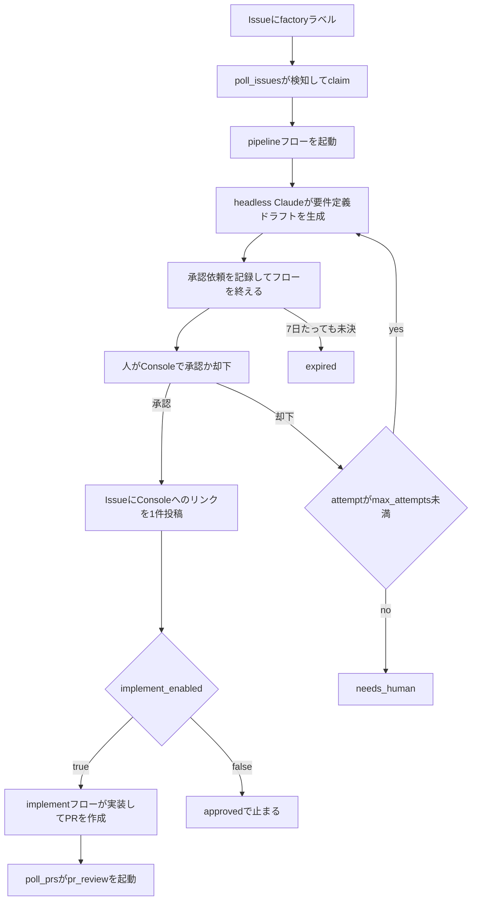
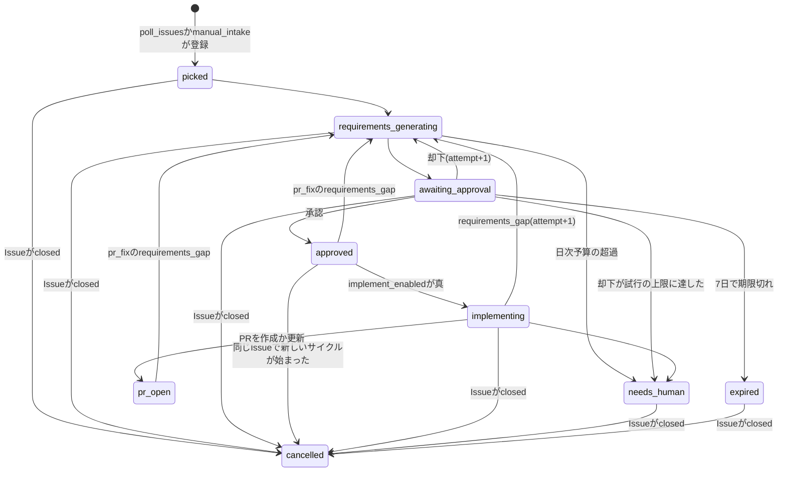
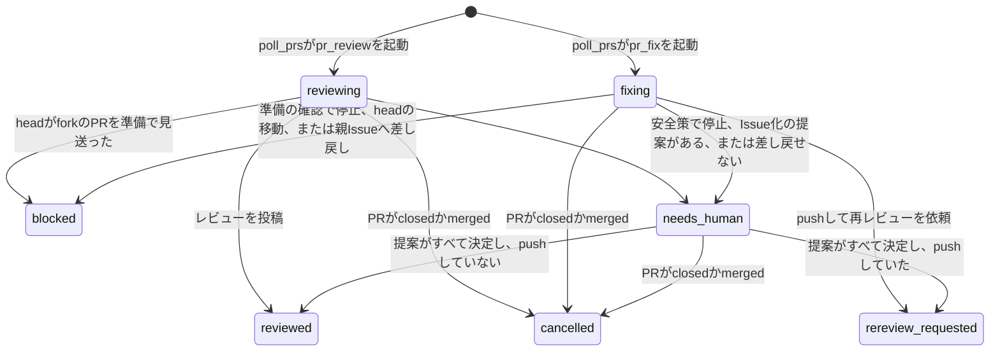
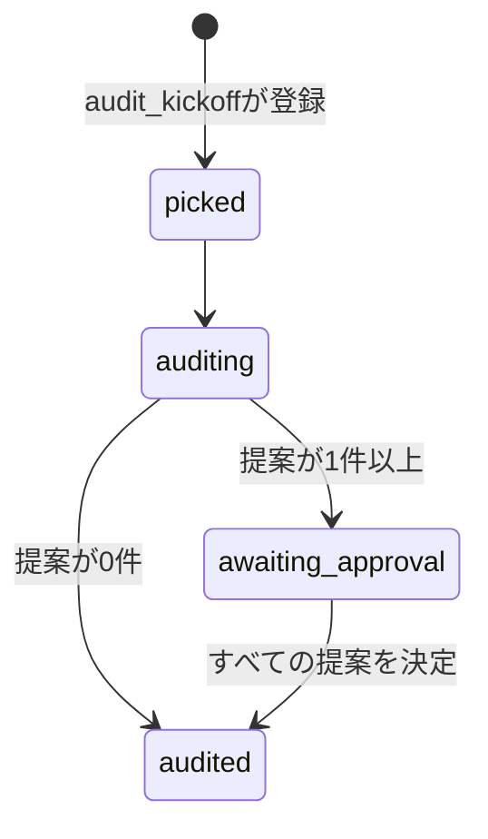
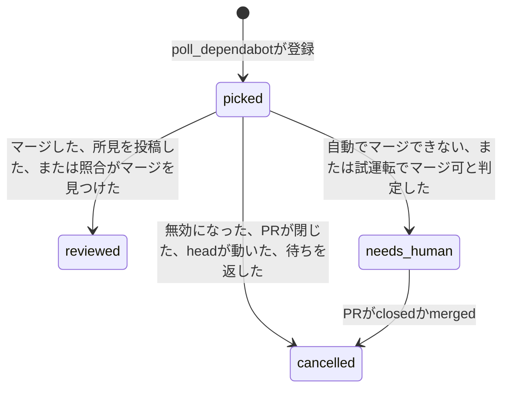

# アーキテクチャ

Software Factoryの構成と、作業がどの順に流れるかを説明する。Factoryを変更する人が、全体の地図として最初に読む文書である。
内部の挙動と設定値は、[作業項目の状態とリース](internals/work-items.md)などの内部仕様の文書に書く。
文書の一覧は[README](../README.md)の「文書」にある。

## 概要

Software FactoryはGitHub Issueを起点に、要件定義から自己改善までをWindmill上のフローで自動化する。入力は`factory`ラベルが付いたIssueと、`factory:review`か`factory:fix`のラベルが付いたPRである。

| コンポーネント | 役割 |
| --- | --- |
| GitHub | Issue、PR、コメントのやり取り先。Factoryはここに成果物だけを書く |
| Windmillのserverとworker | フローとスケジュールの実行基盤 |
| Data Tables | 作業の状態、要件定義ドラフト、承認依頼、実行ログ、失敗記録を持つPostgresのテーブル群 |
| Factory Console(`console/`) | 承認と却下、失敗の再実行、通知の解決、保留と凍結の確認と解除、作業項目の進捗、要件定義書と監査レポートの閲覧、コストの分析、システムの状態を提供する。Vite + Reactで作る。専用のワークフロー(`console-dist.yml`)が組み立てて成果物`console-dist`にし、`console_fetcher`が取り込み、Caddyが`/console/`で配信する |
| Discord | 拾い上げ、承認待ち、承認、要対応、失敗などのイベントをWebhookで通知する |

Claudeを動かすworker(`windmill_worker`)はカスタムイメージで動く。
このイメージには、Claude Code CLI(`claude`)、`gh`、git worktree runner(`gtr`)、`gitleaks`、`wmill`を同梱する。
このworkerはdefaultワーカーグループの1コンテナで、同時に動かすジョブは1つである。
nativeでないworkerは、コンテナにつき1つしか動かない(Windmillの制限)。
`NUM_WORKERS`を2以上にしても、Windmillが1に戻す。
そのため、Claudeのジョブが動く間、defaultのworkerで動く定期のジョブは待つ。
定期ジョブ用のworker(下記)で動かすscriptを選ぶ基準と、選定の結果は[セキュリティ](security.md#tagを付けるscriptの選び方)にある。
現在、tag`periodic`で動くのは、`notify_daily_summary`、`auto_retry_pr_review`、`default_worker_watch`である。
ほかの定期ジョブは、defaultのworkerで動き、Claudeのジョブの間は待つ。
ただし、tag`console`を付けた`audit_kickoff`と`console_fetch_watch`は、Console用のworkerで動く。
メモリの上限はコンテナ全体で4096Mである。

Consoleの問い合わせと操作の受付専用のworkerが、別のコンテナ(`windmill_worker_console`)で動く。
Claudeの長いジョブがdefaultワーカーグループの枠を埋めても、問い合わせと操作の受付を止めないためである。
受け付けたscriptが起動するフローとハンドラは、defaultのworkerで動く。
承認のハンドラ、再実行したpipeline、監査のフローがそうであり、defaultに空きができるまで待つ。
このworkerはワーカーグループ`console`に属し、tag`console`のジョブだけを受ける。
どのscriptをこのworkerで動かすかは、scriptの`tag`で決める。
上流のWindmillイメージで動き、nativeでないworkerなので、同時に動かすジョブは1つである。
1件のジョブが止まっている間は、ほかのジョブが待つため、このworkerで動かすscriptには`timeout`を付ける。
メモリの上限は1024Mである。
`factory_state`は要件定義書のサブパス`requirements`だけを、`factory_console`は全体を読み取り専用でマウントし、`factory_workspaces`はマウントしない。

定期ジョブ専用のworkerが、別のコンテナ(`windmill_worker_periodic`)で動く。
定期ジョブを、Claudeの長いジョブの待ちから切り離すためである。
このworkerはワーカーグループ`periodic`に属し、tag`periodic`のジョブだけを受ける。
どのscriptをこのworkerで動かすかは、scriptの`tag`で決める。
tag`periodic`を付けるのは、ファイル、独自イメージの道具、cgroupのどれにも依存しない定期ジョブである。
読むsecret変数は、scriptごとに決める。
通知を送る定期ジョブが`discord_webhook_url`を、収集の`collect_github`が`github_read_tokens`を読む。
`claude_oauth_token`、`github_token`、`wmill_token`は届かせない。
依存するジョブは、defaultのworkerで動かす。
tag`periodic`のジョブが13分以上待つと、defaultのworkerで動く`self_update`が検知して通知する([運用](operations.md#定期ジョブ用のworkerの検知を確かめる))。
逆に、defaultのworkerが止まったことは、このworkerで動く`default_worker_watch`が5分ごとに検知して通知する([運用](operations.md#defaultのworkerの検知を確かめる))。
止まったworkerの中のscriptは動かないので、片方だけが止まるときは、もう一方のworkerで動くscriptが拾う。両方が止まる障害は拾えない。
scheduleの失敗を拾う検出器(`detect_schedule_failures`)も、このworkerで動かす。
defaultのworkerで動かすと、長いジョブが枠を塞ぐ間、失敗の検知が止まるためである。
検出器が止まったことは、`default_worker_watch`が同じ回で検知して通知する([運用](operations.md#scheduleの失敗の検出))。
上流のWindmillイメージで動き、nativeでないworkerなので、同時に動かすジョブは1つである。
1件のジョブが止まっている間は、ほかのジョブが待つため、このworkerで動かすscriptには`timeout`を付ける。
メモリの上限は1024Mである。
信頼できない入力を扱うジョブは動かさないので、`factory_workspaces`と`factory_state`はマウントしない。

## パイプライン

作業は工程1から工程5の順に進む。工程番号はWindmillの資産のsummaryにも使う(下の命名規則を参照)。

| 工程 | 内容 |
| --- | --- |
| 1. 拾う | `factory`ラベル付きのIssueを検知してclaimする |
| 2. 要件定義 | headless Claudeが要件定義ドラフトを生成し、人が承認か却下をする |
| 3. 実装 | 承認済みの要件定義からworktree上で実装し、PRを作る。既定では無効 |
| 3. PRレビュー・修正 | 既存のPRをレビューし、指摘を修正する |
| 4. mainのCI監視 | 対象リポジトリのmainのCIをコミット単位で監視し、失敗を通知する |
| 4. PRのCI監視 | Factoryが作ったPRのCIをheadのコミット単位で監視し、失敗を通知する。設定で有効にしたときは、失敗を直す作業項目も起動する |
| 5. 自己改善 | 運用記録を週次で監査し、レポートと改善提案を作る |

工程3の実装フロー(`implement`)は、`factory_config`の`implement_enabled`を`true`にしたときだけ動く。既定値は`false`で、その間は要件定義を承認した作業項目が承認済み(`approved`)のまま残る。

工程をまたいで、Factory Console、自己更新(`self_update`)、フローの失敗ハンドラ、スケジュールの失敗の検出器が動く。

承認はWindmillのsuspendではなく、承認依頼のテーブルの行で待つ。pipelineフローは承認依頼を記録した時点で終わり、人の決定は別のscriptが反映する。仕組みは[要件定義の生成と承認](internals/requirements.md)に書く。
設計フロー(`f/factory/design`)は、承認済みの要件定義から設計書を作り、同じ形で承認依頼を記録して終わる。
入口が閉じていて、本番では動かない。
仕組みは[設計書の生成](internals/design.md)に書く。

`owners`に`id`があるオーナーは、GitHubの現在のIDと2か所で照合する。
1つは、発見の入口である`poll_issues`と`poll_prs`である。
もう1つは、作業項目を進める処理である。
準備のステップは、`pipeline_prepare`、`implement_prepare`、`pr_fix_prepare`、`pr_review_prepare`である。
ほかに、フォームからのIssueの作成(`manual_intake_create_issue`)と、Issue化の提案の処理(`issue_proposal_apply`)がある。
どれも、cloneやGitHubへの書き込みの前に、リポジトリのオーナーを`owners`と照合する。
`owners`に無いオーナーのリポジトリは、`factory_repo`でなければ止める。
`factory_repo`と一致するリポジトリは、`factory_repo_id`があれば、同じ関門がそのIDも照合する。
オーナーが改名して別の人がその名前を取得した場合に、その人のリポジトリを取得したり、実行したりしないためである。
設定と限界は[運用](operations.md)の「オーナーの数値IDを固定する」に書く。

## 状態遷移

作業項目(`work_items`)の状態は`status`列だけが持つ。GitHubのラベルは人からFactoryへのトリガーに限り、状態を表さない。

### 状態の一覧

作業項目の種別(`kind`)は5つある。
Issueは`issue`、PRレビューは`pr_review`、PR修正は`pr_fix`、監査は`audit`、dependabotのセキュリティ更新PRは`dependabot`である。

| status | 意味 | 種別 | 終端 |
| --- | --- | --- | --- |
| `picked` | claimした直後。監査とdependabotでは作業項目を作った直後 | issue、audit、dependabot | |
| `requirements_generating` | 要件定義ドラフトを生成している | issue | |
| `awaiting_approval` | 人の承認を待っている | issue、audit | |
| `approved` | 要件定義が承認された | issue | 終端 |
| `designing` | 設計工程の状態。要件定義の承認の後、実装の前に置く。設計書を生成している。遷移させるコードは入っているが、入口が閉じていて本番では動かない | issue | |
| `awaiting_design_approval` | 設計工程の状態。人の設計の承認を待つ。設計フローが`designing`から移すコードは入っているが、入口が閉じていて本番では動かない | issue | |
| `rejected` | 値は定義されているが、今のコードは作業項目に書き込まない。却下は承認依頼の状態として記録する | issue | 終端 |
| `implementing` | 実装している。worktree上の実装、検証と修正のループ、PRの作成までを含む | issue | |
| `pr_open` | 実装を終えてPRを作成か更新した。PRのCIとマージ後のCIは、作業項目とは別に工程4が監視する | issue | 終端 |
| `reviewing` | PRをレビューしている | pr_review | |
| `reviewed` | レビューをCOMMENTとして投稿した。dependabotでは、マージしたか、影響の所見を投稿した | pr_review、pr_fix、dependabot | 終端 |
| `fixing` | レビューの指摘やコメントを修正している | pr_fix | |
| `rereview_requested` | 修正をpushし、再レビューを依頼した | pr_fix | 終端 |
| `blocked` | 準備の確認でレビューか修正の前に止めた(headがforkのPRなど)、修正の実行中にPRのheadが動いた、要件の不足で親のIssueへ差し戻した | pr_review、pr_fix | 終端 |
| `needs_human` | 自動処理を打ち切り、人の対応を待つ | すべて | 終端 |
| `failed` | 実行時エラーで失敗した | すべて | 終端 |
| `expired` | 承認依頼が7日の期限を過ぎた | issue | 終端 |
| `cancelled` | IssueかPRが閉じられた。または、承認済みの要件定義が、同じIssueの新しいサイクルに置き換えられた。dependabotでは、フローがheadを判断せずに止めた | すべて | 終端 |
| `auditing` | 監査している | audit | |
| `audited` | 監査を終えた | audit | 終端 |

pr_fixの作業項目は、Issue化の提案がある間は人の対応待ち(`needs_human`)で待つ。提案がすべて決定すると、レビュー済み(`reviewed`)か再レビュー依頼(`rereview_requested`)へ移る。監査の作業項目は、承認待ち(`awaiting_approval`)で提案の決定を待つ。

設計工程の2状態(`designing`、`awaiting_design_approval`)は、設計フローが前者から後者へ移すコードまでが入っている。
ただし、設計フローの入口が閉じていて、本番の作業項目はこの2状態にならない。
そのため、下の状態遷移の図に載せない。
設計フローは[設計書の生成](internals/design.md)に書く。

終端の一覧はコードとDBのviewの2か所にある。そろえ方は[作業項目の状態とリース](internals/work-items.md)に書く。

### Issueの作業項目

### PRの作業項目

### 監査の作業項目

### dependabotの作業項目

人に回すと決めたPRは、`poll_dependabot`が作業項目を作った直後に人の対応待ちにする。
注記と分岐は[dependabotの更新の内部仕様](internals/dependabot.md)に書く。

図に描いていない遷移が3つある。
終端でない作業項目は、フローが例外で失敗するか孤児と判定されると失敗(`failed`)になる。
Issueの作業項目とPRの作業項目は、IssueかPRが閉じられると取り消し(`cancelled`)になる。
失敗の作業項目も、IssueかPRが閉じられると取り消しになる。
この取り消しは、図に描いた人の対応待ちと期限切れからの取り消しと同じで、Consoleの要対応の一覧から外すためのものである。
閉じた人が許されるときだけ取り消す。
許されるのは、PRがマージされたとき、作者以外の人が閉じたとき、作者が閉じて作者の関係が許可する関係(`allowed_labeler_associations`)に当たるときである。
Botが閉じたときは取り消さない。

終端の作業項目は、Consoleからの再実行で再び動き出す。監査とdependabotの作業項目は再実行できない。遷移の条件、リース、孤児の判定は[作業項目の状態とリース](internals/work-items.md)に書く。

## データモデル

Data Tablesはスキーマ`factory`に置く。migrationは追加だけにし、列やテーブルの名前は変えない。列の定義はmigrationのファイル(`migrations/datatable/main/`)を参照する。

### テーブル

| テーブル | 役割 |
| --- | --- |
| `work_items` | 作業項目1件の状態。`(owner, repo, issue_number, cycle)`で一意 |
| `work_item_events` | 状態遷移の履歴。遷移を起こしたステップのジョブIDと、そのフローのルートジョブIDを持つ |
| `requirement_drafts` | 要件定義ドラフト。attemptごとに本文、図の参照、未確定事項、ファイルの置き場所(`doc_dir`)を持つ |
| `design_drafts` | 設計の下書き。要件定義の下書きに結び付き、本文、図の参照、未確定事項、ファイルの置き場所、読んだコミットを持つ |
| `approval_requests` | 承認依頼。要件定義の承認とIssue化の提案の承認の両方を持つ。設計の承認依頼(`design`)を記録するコードは入っているが、本番では作られない |
| `approvals` | 承認と却下の古い履歴。今は書き込まない |
| `agent_runs` | Claudeの実行1回ごとのモデル、トークン数、費用、所要時間、終了コード。実際に使われたモデルごとの内訳(`model_usage`)も持つ |
| `job_failures` | フローの失敗の記録。失敗を記録したジョブのルートジョブIDも持つ。トークンはマスクしてから書く |
| `deployments` | 自己更新によるデプロイの結果。変更したパスと、含まれるPR(`pull_requests`)、失敗の理由(`error`)も持つ |
| `notices` | 人が対応すべき事項。PATの失効やSHAの不一致など。解決した人と時刻(`resolved_by`、`resolved_at`)も持ち、DBの掃除が解決した行の`resolved_by`は`cleanup_db`になる |
| `reviews` | pr_reviewの実行1回ごとの判定、修正必須の指摘の有無(`result`)、総評、指摘、投稿したレビューのID |
| `fix_rounds` | pr_fixの実行1回ごとの結果、返信、コミット |
| `implement_rounds` | 実装フローのClaude実行1ラウンドごとの記録 |
| `issue_proposals` | Issue化の提案の題名と本文、決定の履歴 |
| `audit_reports` | 監査1回のレポート。作業項目と1対1に対応する |
| `cleanup_runs` | DBの掃除1回ごとの削除件数 |
| `drawio_viewer_observations` | draw.ioのリリースのタグごとに、最初に見たcommitと時刻。ビューアの固定を上げる処理が、14日の待ちを数えるのに使う |
| `main_ci_runs` | 既定ブランチのコミットごとのCIの判定結果。作業項目とは独立した読み取り専用の記録で、判定を待つ行と判定済みの行を持つ |
| `pr_ci_checks` | FactoryのPRのheadごとのCIの判定結果。設定`pr_ci_watch_human_prs`が`true`のときは、許可された人が作ったPRの行も持つ。作業項目とは独立した記録で、判定を待つ行と判定済みの行を持つ。作業項目のIDは、外部キーを持たず値だけで参照する。人のPRの行は、作業項目のIDが空である。CIの失敗を直す作業項目の結果待ちの状態(`fixing`)と、直す作業項目へのIDなどの列を持つ。直す作業項目の起動は`watch_pr_ci`が行う([PRのCI監視の内部仕様](internals/pr-ci.md)) |
| `pr_conflict_checks` | FactoryのPRのマージの競合の記録。PRごとに1行で、競合を見つけたPRだけが行を持つ。競合を見たときのheadのコミットと、PRの何回目の競合か(`episode`)と、今の競合で通知した時刻を持つ。競合を直す側の列として、直している作業項目のID、今の競合の回で起動した回数、起動の保留理由、今の競合の回が始まった時刻を持つ。作業項目とは外部キーを持たず、IDの値だけで結ぶ。競合から離れた行はDBの掃除が消す([PRのCI監視の内部仕様](internals/pr-ci.md#競合の検知)) |
| `gh_repos` | GitHubの所有者のリポジトリごとの状態。所有者、リポジトリ、数値ID、許可の有無、既定のブランチ(取らないので空)、archive済みか、開いているPRとトリガーラベル付きのIssueの件数、一覧から消えたか(`gone`)とその理由を持つ。詳細を最後に取り終えた時刻(`last_collected_at`)と着手した時刻、打ち切りと失敗の印も持つ。一覧を取り終えた所有者だけを書き直し、消えた行は残す。作業項目とは独立した記録で、外部キーを持たない。`poll_dependabot`と`poll_issues`と`poll_prs`と`watch_pr_conflicts`は収集の2つの設定が真のときに、`watch_pr_ci`は収集の2つの設定が真で、設定`pr_ci_watch_human_prs`が`true`のときに、鮮度の判定に読む([GitHubの収集](internals/github-collect.md)) |
| `gh_collect_runs` | `collect_github`の実行の記録。所有者ごとに1行で、始めに空の行を書き、終わりに更新する。成否、失敗の種類とその段、照合の結果、GraphQLの費用と要求数、詳細を取った件数、通信を控える時刻を持つ。保持期間を過ぎた行はDBの掃除が消す([GitHubの収集](internals/github-collect.md)) |
| `gh_pull_requests` | GitHubの開いているPRの記録。リポジトリの番号ごとに1行で、headのコミットとブランチ名、作者、ドラフトかとforkか、競合の有無、ラベルの有無、レビュー依頼とassigneeの数値IDを持つ。題と本文は持たない。行を使ってよいかを`usable`で表す。作業項目とは独立した記録で、外部キーを持たない。`poll_dependabot`と`poll_prs`と`watch_pr_conflicts`は収集の2つの設定が真のときに、`watch_pr_ci`は収集の2つの設定が真で、設定`pr_ci_watch_human_prs`が`true`のときに、候補の列挙に読む([GitHubの収集](internals/github-collect.md#詳細の表)) |
| `gh_issues` | GitHubのトリガーラベル付きの開いているIssueの記録。リポジトリの番号ごとに1行で、作者と作成と更新の時刻を持つ。題と本文は持たない。作業項目とは独立した記録で、外部キーを持たない。`poll_issues`が、収集の2つの設定が真のときに、候補のIssueの発見に読む([GitHubの収集](internals/github-collect.md#詳細の表)) |
| `worker_samples` | defaultのworkerの負荷の2分ごとの記録。枠を使うジョブの数とscriptごとの内訳、待つジョブの数と最長の待ち、予定時刻と開始の遅れ、コンテナのメモリを1行に並べる。読めなかった値は空のまま残す。作業項目とは独立した読み取り専用の記録で、保持期間を過ぎた行はDBの掃除が消す |
| `holds` | 共通の保留。対象を進めないことを、期限つきで伝える。範囲は自動マージ(`merge`、主体ごとに重ねられる)とIssueの取り込み(`claim`、排他、読み手なし)で、置いた主体の名乗り、期限、閉じた時刻と閉じた理由を持つ。作業項目とは独立した記録で、外部キーを持たない。行は消さず履歴として残す([保留の内部仕様](internals/holds.md)) |

`work_items`の列は種別によって使うものが違う。実装ブランチ(`branch`)と作成したPRのURL(`pr_url`)はIssueの作業項目だけが持ち、PR番号(`pr_number`)はPRの作業項目だけが持つ。PR番号をIssueの作業項目に入れないのは、PRの作業項目の束ね方がこの列で決まるためである。実装ブランチの名前は`factory/issue-<N>-wi-<id>`である。

`agent_runs`には、Claudeの不正な出力を再試行したときに捨てた最初の試行も、同じattemptの別の行として記録する。費用が分かるときは、その費用も日次予算の集計とコストの分析に含める。出力がJSONとして読めないときは費用が分からない。

`implement_rounds`の主な列は次のとおり。行は作業項目の削除にあわせて消える。

| 列 | 内容 |
| --- | --- |
| `round` | 作業項目の中の連番。`(work_item_id, round)`で一意 |
| `mode` | `implement`か`fix` |
| `outcome` | `done`、`requirements_gap`、`check_failed`、`checks_skipped`、`stalled`、`error`のいずれか |
| `check_output` | 検査の出力。16KBに収まらないときは先頭と末尾 |
| `protected_changes` | 保護パスの変更の一覧(jsonb) |
| `diff_stat` | 差分の量。`{files, added, deleted}`の形のjsonb |

ほかに`summary`、`gap_report`、`checks_skipped_reason`、`agent_run_id`を持つ。

`issue_proposals`は提案の題名、本文、レビューコメントのID、スレッドのIDを持つ唯一の場所で、`approval_requests`はこれらを複製しない。提案の出どころ(`origin`)は`pr_fix`か`audit`である。監査の提案は`audit_report_id`と`position`でレポートに結びつき、レビューコメントのIDは持たない。

`audit_reports`は本文を`markdown`列に持ち、証跡の数値を`metrics`列に持つ。

### view

Consoleの一覧と集計は次のviewを読む。

| view | 内容 |
| --- | --- |
| `v_inbox` | 承認の一覧 |
| `v_pipeline` | 作業項目の進捗の一覧 |
| `v_agent_cost_daily` | Claudeの実行の日ごとの費用 |
| `v_agent_usage_daily` | Claudeの実行の、日、モデル、バージョン、工程ごとの使用量(費用、トークン数、ターン数、実行時間) |
| `v_agent_model_usage_daily` | Claudeの実行の、日、実際に使われたモデル、バージョン、工程ごとの使用量(費用、トークン数) |
| `v_approval_stats` | 承認と却下の集計 |
| `v_lead_time` | 作業項目が終端になるまでの時間 |
| `v_failures` | 失敗の一覧 |
| `v_notices` | 要対応事項の一覧 |
| `v_issue_proposals` | Issue化の提案の一覧 |
| `v_approval_requests` | 承認依頼の一覧 |
| `v_audit_reports` | 監査レポートの一覧 |
| `v_reviews` | PRレビューの一覧 |
| `v_fix_rounds` | PR修正の一覧 |

要件定義書と監査レポートの詳細表示では、Consoleのbackend(`f/factory/steps/console_query.ts`)がテーブルを直接読む。読むのは`requirement_drafts`、`audit_reports`、`approval_requests`、`issue_proposals`、`work_items`である。

更新履歴の表示では、`console_query`の`deployments`viewが`deployments`テーブルを新しい順に読む。選ぶのは、版、結果、ホストの作業の要否、時刻、含まれるPR、失敗の理由で、変更したパスの一覧は選ばない。

`console_query`は、行の配列を返すviewのほかに、1つのオブジェクトを返す3つのviewを持つ。

| view | 内容 |
| --- | --- |
| `summary` | サイドバーの件数と、要対応の一覧。承認待ち、作業項目の失敗、要対応の通知を返す |
| `work_item_detail` | 作業項目1件の概要、要件定義の試行、承認の履歴、実装のラウンド、失敗、状態の遷移とそのジョブID。PRの作業項目では、レビューと修正の一覧(件数だけ)も返す。検査コマンドの出力は返さない |
| `system_status` | 反映の状態、Consoleの取り込みの状態、作業項目の無い失敗、情報の通知、解決済みの通知、defaultのworkerの直近24時間の負荷 |

次の10本のscriptは、tag `console`を付け、Console用のworkerで動かす。

- `console_query`
- `approval_decide`
- `retry_work_item`
- `audit_kickoff`
- `notice_resolve`
- `manual_intake_submit`
- `console_fetch_watch`
- `console_holds`
- `hold_release`
- `freeze_release`

どれも、Claudeの長いジョブがdefaultのworkerの枠を埋めても、Consoleを止めないためである。

## フローとスケジュール

### フロー

<!-- generated:flows -->
| フロー | 起動元 | 内容 |
| --- | --- | --- |
| `manual_intake` | `manual_intake_submit`(Consoleの新規投入)、人がフォームから実行 | 手動投入フォーム(Issueを作成して工程に乗せる) |
| `pipeline` | `design_generate`、`implement_finish`、`manual_intake_register`、`poll_issues`、`pr_fix_finish`、`requirements_apply`(Consoleの承認と却下)、`retry_work_item`(Consoleの再実行) | 要件定義の生成と承認 |
| `design` | `requirements_apply`(Consoleの承認と却下) | 設計書の生成と承認 |
| `pr_review` | `auto_retry_pr_review`、`poll_prs`、`retry_work_item`(Consoleの再実行) | PRの自動レビュー |
| `pr_fix` | `auto_retry_stale_image`、`poll_prs`、`retry_work_item`(Consoleの再実行)、`watch_pr_ci`、`watch_pr_conflicts` | レビュー指摘の修正と再レビュー依頼 |
| `implement` | `auto_retry_stale_image`、`requirements_apply`(Consoleの承認と却下)、`retry_work_item`(Consoleの再実行) | 実装とPR作成 |
| `dependabot` | `poll_dependabot` | 依存の更新PRの検査と自動マージ |
| `audit` | `audit_kickoff`(Consoleの今すぐ監査) | 運用記録の監査と改善提案 |
<!-- /generated:flows -->

起動元は、flowを起動するscriptの名前である。
括弧は、そのscriptをConsoleから動かせる操作の例で、スケジュールによる起動は示さない。
たとえば`audit`は、Consoleの今すぐ監査のほかに、`audit_kickoff`の週次のスケジュールでも起動する。
起動元の一覧は`scripts/launch-graph.ts`の`LAUNCH_EDGES`から作る。
同じ表から、Consoleのシステムの画面に出す起動関係の図のデータ(`console/src/generated/flow-graph.json`)も作る。
`wmill.runFlowAsync`を呼ぶscriptを足したときは、`LAUNCH_EDGES`にも足す。
足し忘れると、`tests/scripts/launch-graph.test.ts`が失敗する。
辺だけを残して起動のコードを消したときと、`*_FLOW_PATH`の定数を足したときも、同じテストが失敗する。
テストには、検出できない形もある。
別名の変数で呼ぶ起動、`wmill.`を付けない呼び出し、包みの関数だけでflowを起動するscriptは、見落とす。
そのような起動を足したときは、人が表を確かめる。

- `manual_intake_register`は、manual_intakeの最後のステップで、登録したIssueの要件定義を始める。
- `pr_fix_finish`と`implement_finish`は、pr_fixとimplementの最後のステップで、要件の不足を見つけたときに要件定義へ差し戻す。
- `auto_retry_stale_image`は、`self_update`が起動する。
- `requirements_apply`は、`approval_decide`が承認か却下を記録した後に起動する。

承認、却下、期限切れの分岐はフローの外にある。人の決定は`approval_decide`が記録し、期限切れは`poll_issues`が判定する。

フローが失敗すると、各フローの失敗時のステップ(`failure_module`)が`on_error_flow`を呼ぶ。`on_error_flow`は失敗を`job_failures`に記録し、作業項目を失敗にして、Discordに通知する。IssueやPRには何も書かず、ラベルにも触れない。

### スケジュール

<!-- generated:schedules -->
| スケジュール | cron(秒 分 時 日 月 曜日) | 実行するもの | 内容 |
| --- | --- | --- | --- |
| audit_kickoff | `0 30 9 * * 1` | `f/factory/audit_kickoff` | 毎週月曜09:30(Asia/Tokyo)に実行します。前回の監査レポート以降の運用記録(失敗・却下・要人手・コスト・通知・デプロイ)に行動につながる記録があれば、監査の作業項目を作成して監査フローを起動します。記録が無い場合、別の監査が実行中の場合、日次予算を超過している場合は何もしません。 |
| auto_retry_pr_review | `30 2-59/5 * * * *` | `f/factory/auto_retry_pr_review` | 5分ごとに実行します。GitHubの5xxや通信断で失敗したPRレビューを、失敗から再開の回数に応じた待ち(5分、15分、45分)が過ぎていれば同じ作業項目のまま再開します。ラベルは付け直さず、再開は同じ作業項目につき3回までです。 |
| cleanup_db | `0 30 3 * * *` | `f/factory/cleanup_db` | 毎日3:30に実行します。終端状態(承認済み・却下・要対応・タイムアウト・失敗・レビュー済み・再レビュー依頼・ブロック・キャンセル・PR作成済み・監査完了)になった作業項目を既定90日(`factory_config`の`retention_work_items_days`で変更可)で削除し、あわせて要件定義ドラフトや承認依頼などの関連データも削除します。失敗記録・デプロイ記録・解決済みのお知らせは既定30日(`retention_logs_days`)で個別に削除します。古い「情報」の未解決のお知らせは、削除せず同じ期間で解決済みにします。判定済みのmainのCIの記録も同じ期間(`retention_logs_days`)で削除し、判定を待つ記録と、各リポジトリの最新の記録は削除しません。PRのCIの記録も同じ期間で削除します。判定を待つ記録と失敗を直している記録は削除せず、各PRの最新の記録は保持期間の4倍まで残します。workerの負荷の記録も同じ期間で削除します。 |
| cleanup_workspaces | `0 0 3 * * *` | `f/factory/cleanup_workspaces` | 毎日3:00に実行します。処理が終わった作業用ディレクトリや、動かなくなった処理の後始末を行い、保存領域の使用量を記録します。 |
| collect_github | `0 1-59/5 * * * *` | `f/factory/collect_github` | 5分ごとに実行します。設定のownersの所有者ごとに、読み取り専用のトークンでリポジトリの一覧と、開いているPRとトリガーラベル付きのIssueの件数を集めて、DBに書きます。設定のgh_collect_detail_enabledがtrueのときは、続けてPRとIssueの詳細も集めて書きます。設定のgh_collect_enabledがfalseの間は、トークンを読まず、何も書きません。毎日9時0分の日次サマリ通知と重ならないよう、毎時1分から5分おきに実行します。 |
| console_fetch_watch | `0 */10 * * * *` | `f/factory/console_fetch_watch` | 10分ごとに実行します。Consoleの取り込み(console_fetcher)が書く状態を読み、失敗、更新の停止、状態が読めないことを、通知に残し、新しく残したときだけDiscordに知らせます。rate limitなどの一時的な失敗は、60分以上続いたときだけ知らせます。正常に戻っても通知は自動では解決しません。 |
| default_worker_watch | `45 4-59/5 * * * *` | `f/factory/default_worker_watch` | 5分ごとに実行します。defaultのqueueに予定時刻から10分以上待つジョブがあり、defaultで動いているジョブが1つも無いときだけ、defaultのworkerが止まっているとして通知を残し、Discordにも知らせます。長いClaudeのジョブが枠を塞いでいるだけのときは知らせません。待ちが解けると通知を自動で解決します。 |
| detect_schedule_failures | `20 3-59/5 * * * *` | `f/factory/detect_schedule_failures` | 5分ごとに実行します。scheduleが起こしたジョブの失敗をジョブ履歴から拾って記録し、連続した失敗の初回とエラー文が変わったときはDiscordに知らせ、直近3回の実行が続けて失敗していれば要対応の通知を残します。このWindmillではscheduleの失敗時の呼び出し(on_failure)が働かないため、失敗を拾う入口はこのscheduleだけです。止まると、defaultのworkerの停止を見張る確認が通知を残します。 |
| drawio_viewer_bump | `0 0 10 * * 1` | `f/factory/drawio_viewer_bump` | 毎週月曜の10:00に実行します。draw.ioの公式のリリースを確かめ、公開から14日以上たった最新の版に固定(`console/drawio-viewer.json`)を上げるPRを作ります。メジャー版が変わるPRは、題名に[major]を付け、本文の先頭で人の確認を求めます。PRには自動レビューのラベルを付けます。未完了の更新のPRがあるあいだと、同じ版のPRを作った後は、何もしません。ビューアの大きさが2割を超えて変わる版と、取得物がGitHubの記録と一致しない版は上げず、お知らせに残します。 |
| notify_daily_summary | `0 0 9 * * *` | `f/factory/notify_daily_summary` | 毎日9:00(Asia/Tokyo)に実行します。前日分の実行回数・コスト・失敗回数と承認/却下の件数、workerの負荷を集計し、Discordへ日次サマリを投稿します。`review_post_mode`が`gated`のときは、レビューの投稿欄を足し、投稿しない状態が3日以上続けばConsoleの要対応にnoticeを追加し、投稿するモードに戻れば解決します。予定が飛んだ日があれば、最後に出した日の翌日から古い順に、最大7日分まで出します。 |
| poll_dependabot | `0 */10 * * * *` | `f/factory/poll_dependabot` | 10分ごとに実行します。設定のdependabot_enabledが無効なら何もしません。有効なら、dependabotが開いた、mainをbaseにする、draftでないPRを探し、自動でマージする条件をフローと同じ検査で確かめます。条件を満たしたPRだけ、依存の更新PRの検査と自動マージのフローを起動します。待つ間は何も作らず、待ちが長引いたPRや条件を満たさないPRは、人の対応待ちにして1回だけ通知します。同じPRにレビューか修正の処理が動いている間と、同じheadを処理した後は、選びません。 |
| poll_issues | `0 */5 * * * *` | `f/factory/poll_issues` | 5分ごとに実行します。稼働確認とデプロイ状況の通知を行い、担当リポジトリのIssueを収集の表から見つけ、表を使えない明示リポジトリはRESTの一覧で読んで、担当を確定します。あわせて、進行中のすべての作業項目をGitHub側の状態と突き合わせ、後始末が必要なものを処理します。失敗、人の対応待ち、期限切れの作業項目は、対象のIssueやPRが閉じられていれば取り消して、要対応の一覧から外します。 |
| poll_prs | `0 */5 * * * *` | `f/factory/poll_prs` | 5分ごとに実行します。PRにレビュー依頼のラベルが付いている、レビューをリクエストされている、または担当者(assignee)に指定されている場合はレビュー処理を開始します。修正依頼のラベルが付いている場合は修正処理を開始します。PRは収集の表から見つけ、表を使えない明示リポジトリはRESTの一覧で読みます。作業項目の後始末はIssueの巡回処理側で行います。 |
| sample_worker_load | `30 */2 * * * *` | `f/factory/sample_worker_load` | 2分ごとに実行し、defaultのworkerの枠の占有、queueの待ち、コンテナのメモリを記録します。ポーリングの間隔やジョブのメモリを見直す根拠にします。 |
| self_update | `0 */2 * * * *` | `f/factory/self_update` | 2分ごとに実行します。Software Factory自身の最新のコミットを取り込み、変更があればWindmillへの反映とデータベースの更新を自動的に行います。ホスト側の変更(workerイメージの再ビルドなど)はホストで起動し直すまで反映されないため、要対応の通知とDiscordで知らせ、反映が済んだら通知を解決します。更新の最後に、Console用のworkerが止まっていないかを確かめ、止まっていれば通知を残してDiscordにも知らせます。 |
| watch_main_ci | `0 */5 * * * *` | `f/factory/watch_main_ci` | 5分ごとに実行します。対象リポジトリの既定のブランチ(main)へのpushで動いたGitHub Actionsの結果をコミット単位で判定します。失敗したコミットは要対応の通知とDiscordで知らせ、同じリポジトリの新しいコミットが通ったら失敗の通知を自動で解決します。実行を読む権限が無いリポジトリは、権限の不足を通知します。 |
| watch_pr_ci | `0 */5 * * * *` | `f/factory/watch_pr_ci` | 5分ごとに実行します。Factoryが作ったPRのGitHub Actionsの結果をheadのコミット単位で判定します。失敗したheadは要対応の通知とDiscordで知らせ、同じPRのheadが通ったら失敗の通知を自動で解決します。閉じたPRの記録は整理します。実行を読む権限が無いリポジトリは、権限の不足を通知します。設定で有効にしたときは、失敗を直す作業項目も起動し、自動で直す対象の失敗は直せるかが決まってから通知します。設定で有効にしたときは、許可された人が作ったPRの失敗も通知します。PRには書き込まず、ログも読みません。 |
| watch_pr_conflicts | `30 */5 * * * *` | `f/factory/watch_pr_conflicts` | 5分ごとに実行します。Factoryが作ったPRにマージの競合があるかを調べ、競合したPRは要対応の通知とDiscordで知らせます。競合が解けたら通知を自動で解決し、閉じたPRの記録は整理します。設定で有効にしたときだけ動き、無効のときはGitHubもDBも読みません。PRには書き込みません。競合を直す設定が有効なときは、通知の前に、競合を直す作業項目を起動します。競合を直す作業項目が結ばれた行を戻す回復は、競合を直す設定に依らず、毎回行います。 |
<!-- /generated:schedules -->

cronはWindmillの6フィールドの形式で、タイムゾーンは`Asia/Tokyo`である。各スケジュールは`no_flow_overlap: true`を持ち、前回の実行が終わっていなければその回を飛ばす。
このWindmillはスケジュールの失敗時の呼び出し(`on_failure`)を呼ばないので、どのスケジュールにも`on_failure`を設定しない。
スケジュールの失敗は、`detect_schedule_failures`がジョブ履歴から拾って記録し、通知する([運用](operations.md#scheduleの失敗の検出))。

生成した表の内容欄より細かい処理の対象は次のとおり。

| スケジュール | 処理の対象 |
| --- | --- |
| `poll_issues` | Issueの検知とclaim、作業項目の照合(reconcile)、再投入の検出、承認依頼の期限切れ。照合ではIssueとPRのclose、孤児になったジョブを見つける。閉じたIssueやPRの失敗、人の対応待ち、期限切れの作業項目は、閉じた人を確かめて取り消し、要対応の一覧から外す |
| `cleanup_workspaces` | 期限を過ぎたworktree(`req-<N>`、`design-<N>`、実装ブランチのworktree、`review-*`、pr_fixのgtrのworktree)、worktreeが無くなったプロセスのロックファイル、孤児になったheadless Claudeのプロセス、終了時に消されなかったジョブごとの一時ディレクトリ。dependabotの作業ツリー(`dependabot-<PR番号>-<sha7>`)は期限を待たず、終端でないdependabotの作業項目が使っていなければ消す。信頼していない依存を入れた作業ツリーで、処理し直すときは準備のステップが作り直すためである。生き残りのプロセスが使っているworktreeは消さず、noticeを残す。ディスクの使用量も記録する |
| `console_fetch_watch` | Consoleの取り込みが共有ボリュームに書く状態(`status.json`)。原因を最初に見た時刻をWindmillのstateに残し、一時的な失敗が続いた長さを測る。重複は通知の側で防ぐ |
| `sample_worker_load` | defaultのworkerの枠の占有、queueの待ち、コンテナのcgroupのメモリ。読めない値は空のまま記録し、例外は投げない。完全には記録できない回をWindmillのstateに数え、続いたときだけnoticeにする。記録の直後に直近の記録を読み、メモリが設定の割合を超えたか、OOMが増えたら、原因ごとにnoticeを残す。待ちと枠の塞がりは通知にしない |
| `notify_daily_summary` | 集計の対象の日のコスト、件数、失敗、DBの掃除の件数、defaultのworkerの負荷の集計。負荷は`worker_samples`を1回のクエリで集計し、読めなくても他の項目は通知する。最後に出した日をWindmillのstateに残し、飛んだ日は古い順に追い付いて出す |

複数のインスタンスを同時に動かすときの排他は、GitHub側のclaimで取る。
Issueはassigneeを追加してからトリガーラベルを外し、外す要求に成功したインスタンスが受け持つ。
PRも同じくトリガーラベルの削除で所有を決め、削除が404なら引く。
外せた後は取り直して残っていないかを確かめる。
取り直しが数回とも失敗したときは、トリガーラベルを付け直して引く。
取り直せないまま始めると、同じPRのサイクルが重なりうるためである。
レビューのラベルは、稼働中のレビューがあっても止まらない。
修正のラベルは、終端でないPR修正がある間だけ止まる。
その修正が終わった後に、1回だけ新しいラウンドが始まる。
この排他はベストエフォートである。
最後の防御は、`work_items`の部分一意インデックス`work_items_active_issue_key`である。
終端でないIssueの作業項目は、`owner`、`repo`、Issueの番号の組ごとに、同時に1つしか持てない。
終端でないPR修正の作業項目も、部分一意インデックス`work_items_active_pr_fix_key`により、`owner`、`repo`、PRの番号の組ごとに同時に1つしか持てない。
これらのインデックスの述語は、終端でない状態を列挙する。
設計工程の2状態は、Issueの`work_items_active_issue_key`と、PR修正の`work_items_active_pr_fix_key`の述語に含める。
dependabotの`work_items_active_dependabot_key`([dependabotの更新の内部仕様](internals/dependabot.md))の述語にも含める。
その状態の間も、同じIssueやPRの作業項目を重ねて作らせないためである。
これらはDBを共有するインスタンスの間で働き、DBを分けたインスタンスが同じリポジトリを扱う構成は対象外である。
1つのリポジトリは1つのインスタンスだけで扱う。

## 命名規則

WindmillのUIはsummaryの順に並ぶので、summaryの先頭に種別のタグを付ける。pathは英数字だけにし、一度決めたら変えない。

| タグの形式 | 対象 |
| --- | --- |
| `[SF-<工程>-<順>] <日本語の表示名>` | 自動で動くフローとスケジュール |
| `[SF-<工程>-<順>/<n>] <日本語>` | フローの中のステップのscript |
| `[OP-<工程>-<順>] <日本語>` | 人がUIから手動で実行するもの |
| `[SYS-<順>] <日本語>` | 基盤と運用の自動処理 |
| `[LIB] <日本語>` | 共有ライブラリ |

工程番号は、1が作業を拾う、2が要件定義、3が実装とPR、4がCI監視、5が自己改善である。Consoleは工程0として扱う。

### 資産の一覧

<!-- generated:assets -->
| path | 種別 | summary |
| --- | --- | --- |
| `f/factory/lib/ci_log_support` | script | [LIB] CIのログの整形と秘密値の検査 |
| `f/factory/lib/ci_fix_classify` | script | [LIB] CIの失敗の分類 |
| `f/factory/lib/ci_fix_round` | script | [LIB] CI回のpr_fixの共通部品 |
| `f/factory/lib/ci_fix_prompt` | script | [LIB] CI回のプロンプト |
| `f/factory/lib/ci_fix_paths` | script | [LIB] CI回の変更ファイルの検査 |
| `f/factory/lib/console_holds_support` | script | [LIB] Consoleの保留と凍結の画面の整形と解除の共通部品 |
| `f/factory/lib/console_status` | script | [LIB] Consoleの取り込みの状態 |
| `f/factory/lib/console_support` | script | [LIB] Consoleの通知の重要度 |
| `f/factory/lib/console_worker` | script | [LIB] Console用workerの停止の検知 |
| `f/factory/lib/db` | script | [LIB] Data Tableアクセス |
| `f/factory/lib/cleanup_db_support` | script | [LIB] DB掃除の純粋ロジック |
| `f/factory/lib/default_worker` | script | [LIB] defaultのworkerの停止の検知 |
| `f/factory/lib/dependabot_registry` | script | [LIB] dependabot更新のnpm registry取得 |
| `f/factory/lib/dependabot_collect` | script | [LIB] dependabot更新のゲート入力の収集 |
| `f/factory/lib/dependabot_support` | script | [LIB] dependabot更新のゲート判定 |
| `f/factory/lib/dependabot_flow_support` | script | [LIB] dependabot更新のフローの支援関数 |
| `f/factory/lib/dependabot_prompt` | script | [LIB] dependabot更新の影響調査のプロンプト |
| `f/factory/lib/discord` | script | [LIB] Discord通知 |
| `f/factory/lib/drawio_viewer_bump` | script | [LIB] draw.ioのビューアの固定の更新 |
| `f/factory/lib/drawio_viewer_bump_github` | script | [LIB] draw.ioのビューアの更新のGitHub操作 |
| `f/factory/lib/drawio_viewer_observations` | script | [LIB] draw.ioのリリースの観測の記録 |
| `f/factory/lib/drawio` | script | [LIB] draw.io図の生成 |
| `f/factory/lib/factory_clone` | script | [LIB] Factory自身のcloneの用意 |
| `f/factory/lib/factory_repo_gate` | script | [LIB] Factory自身のリポジトリの照合 |
| `f/factory/lib/gated_review_support` | script | [LIB] gatedでレビューを投稿しない状態の判定とnoticeの文面 |
| `f/factory/lib/workspace` | script | [LIB] git worktreeと作業領域 |
| `f/factory/lib/github` | script | [LIB] GitHub APIラッパー |
| `f/factory/lib/pr_review_retry` | script | [LIB] GitHubの一時的な失敗で止まったPRレビューの再開 |
| `f/factory/lib/gh_collect_support` | script | [LIB] GitHubの収集の判定 |
| `f/factory/lib/gh_collect` | script | [LIB] GitHubの収集の本体 |
| `f/factory/lib/gh_collect_detail` | script | [LIB] GitHubの収集の詳細の判定 |
| `f/factory/lib/gh_collect_detail_round` | script | [LIB] GitHubの収集の詳細の周回 |
| `f/factory/lib/gh_collect_freshness` | script | [LIB] GitHubの収集の鮮度の監視 |
| `f/factory/lib/github_errors` | script | [LIB] GitHubの呼び出しの失敗の型 |
| `f/factory/lib/claude` | script | [LIB] headless Claude実行 |
| `f/factory/lib/poll_source` | script | [LIB] IssueとPRを見つける経路 |
| `f/factory/lib/claim_support` | script | [LIB] Issue取得の後処理 |
| `f/factory/lib/main_ci_support` | script | [LIB] mainのCIの判定の純粋ロジック |
| `f/factory/lib/main_ci_watch` | script | [LIB] mainのCI監視の流れ |
| `f/factory/lib/ci_metadata_rehash` | script | [LIB] metadataジョブの失敗をhashの再計算で直す |
| `f/factory/lib/owner_id_notice` | script | [LIB] owner_idの照合のnotice |
| `f/factory/lib/pr_fix_launch` | script | [LIB] pr_fixフローの起動 |
| `f/factory/lib/pr_ci_support` | script | [LIB] PRのCIの判定の純粋ロジック |
| `f/factory/lib/pr_ci_watch` | script | [LIB] PRのCI監視の流れ |
| `f/factory/lib/ci_fix_pr_base` | script | [LIB] PRの基点のcommitを求める |
| `f/factory/lib/pr_conflict_support` | script | [LIB] PRの競合の判断 |
| `f/factory/lib/pr_conflict_watch` | script | [LIB] PRの競合の監視の流れ |
| `f/factory/steps/pr_workflow_support` | script | [LIB] PRワークフロー共通処理 |
| `f/factory/lib/schedule_failure_detect` | script | [LIB] scheduleの失敗の検出 |
| `f/factory/lib/schedule_detector_heartbeat` | script | [LIB] scheduleの失敗の検出器の心拍 |
| `f/factory/lib/schedule_failure_report` | script | [LIB] scheduleの失敗の記録 |
| `f/factory/lib/schedule_failure_scan` | script | [LIB] scheduleの失敗の走査 |
| `f/factory/lib/job_ids` | script | [LIB] WindmillのジョブIDの検査 |
| `f/factory/lib/job_state` | script | [LIB] Windmillのジョブの状態の読み替え |
| `f/factory/lib/worker_load_support` | script | [LIB] workerの負荷の記録の部品 |
| `f/factory/lib/process_lock` | script | [LIB] worktree単位のプロセス排他 |
| `f/factory/lib/auto_retry` | script | [LIB] イメージが古くて止まった作業項目の再開 |
| `f/factory/lib/job_tmp` | script | [LIB] ジョブごとの一時ディレクトリ |
| `f/factory/lib/freezes` | script | [LIB] スケジュールの凍結の純粋ロジック |
| `f/factory/lib/freeze_apply` | script | [LIB] スケジュールの凍結の読み込みと追従 |
| `f/factory/lib/prompts` | script | [LIB] プロンプト定義 |
| `f/factory/lib/host_action` | script | [LIB] ホスト側の作業が要る反映の通知 |
| `f/factory/lib/metadata_hash` | script | [LIB] メタデータのhashの再計算 |
| `f/factory/lib/metadata_git_ports` | script | [LIB] メタデータのhashの再計算が読むgitのポート |
| `f/factory/lib/metadata_precheck` | script | [LIB] メタデータのhashの再計算の事前検査 |
| `f/factory/lib/metadata_signature` | script | [LIB] メタデータのmainの引数の比較 |
| `f/factory/lib/metadata_patch_imports` | script | [LIB] メタデータのパッチのimportの読み取り |
| `f/factory/lib/metadata_patch_yaml` | script | [LIB] メタデータのパッチのyamlの検査 |
| `f/factory/lib/metadata_patch_zip` | script | [LIB] メタデータのパッチのzipの読み取り |
| `f/factory/lib/metadata_patch_download` | script | [LIB] メタデータのパッチの取得 |
| `f/factory/lib/metadata_patch_manifest` | script | [LIB] メタデータのパッチの検査 |
| `f/factory/lib/metadata_patch_verify` | script | [LIB] メタデータのパッチの適用条件の検査 |
| `f/factory/lib/log` | script | [LIB] ログとマスク |
| `f/factory/lib/cleanup_support` | script | [LIB] 作業領域掃除の純粋ロジック |
| `f/factory/lib/protected_paths` | script | [LIB] 保護パスの判定 |
| `f/factory/lib/holds` | script | [LIB] 共通の保留の表の読み書き |
| `f/factory/lib/types` | script | [LIB] 共通型 |
| `f/factory/lib/self_update_pull_requests` | script | [LIB] 反映に含まれるPRの解析 |
| `f/factory/lib/gh_collect_read` | script | [LIB] 収集の記録を読む側の判定 |
| `f/factory/lib/intake_refresh` | script | [LIB] 取り込み内容の更新と記録 |
| `f/factory/lib/pr_ci_fix_claim` | script | [LIB] 失敗した行を直してよいかの判断 |
| `f/factory/lib/pr_ci_notify` | script | [LIB] 失敗の通知を出す時機の判断 |
| `f/factory/lib/pr_ci_fix_recovery` | script | [LIB] 失敗を直した行の回復 |
| `f/factory/lib/periodic_worker` | script | [LIB] 定期ジョブ用workerの停止の検知 |
| `f/factory/lib/gh_graphql` | script | [LIB] 宛先を固定したGitHubのGraphQLクライアント |
| `f/factory/lib/implement_finish_support` | script | [LIB] 実装フローの完了処理の判定 |
| `f/factory/lib/implement_loop` | script | [LIB] 実装フローの検証ループ |
| `f/factory/lib/implement_support` | script | [LIB] 実装フローの純粋関数群 |
| `f/factory/lib/implement_launch_support` | script | [LIB] 実装フローの起動判定 |
| `f/factory/lib/repo_owner_gate` | script | [LIB] 対象リポジトリのオーナーIDの照合 |
| `f/factory/lib/model_policy` | script | [LIB] 工程ごとのモデルの選択 |
| `f/factory/lib/manual_intake_support` | script | [LIB] 手動投入の検証とIssue本文 |
| `f/factory/lib/supersede_support` | script | [LIB] 承認の取り消しのコメント |
| `f/factory/lib/approval_support` | script | [LIB] 承認依頼の純粋ロジック |
| `f/factory/lib/approver` | script | [LIB] 承認者の導出 |
| `f/factory/lib/prose_check` | script | [LIB] 文章の検査 |
| `f/factory/lib/summary_support` | script | [LIB] 日次サマリの集計 |
| `f/factory/lib/check_runner` | script | [LIB] 検査コマンドの実行 |
| `f/factory/lib/check_sandbox` | script | [LIB] 検査コマンドの実行ユーザーの切り替え |
| `f/factory/lib/check_sandbox_reasons` | script | [LIB] 検査の前提が古いときの理由 |
| `f/factory/lib/audit_support` | script | [LIB] 監査の期間計算と起動判定 |
| `f/factory/lib/audit_evidence` | script | [LIB] 監査の証跡収集 |
| `f/factory/lib/audit_doc` | script | [LIB] 監査レポートの検査 |
| `f/factory/lib/pr_conflict_fix_claim` | script | [LIB] 競合の行を直してよいかの判断 |
| `f/factory/lib/pr_conflict_fix_recovery` | script | [LIB] 競合を直した行の回復 |
| `f/factory/lib/pr_conflict_fix_holds` | script | [LIB] 競合を直す作業の保留の理由 |
| `f/factory/lib/conflict_fix_prompt` | script | [LIB] 競合回のプロンプト |
| `f/factory/lib/conflict_fix_apply` | script | [LIB] 競合回の修正ステップ |
| `f/factory/lib/conflict_fix_round` | script | [LIB] 競合回の共通部品 |
| `f/factory/lib/conflict_fix_verify` | script | [LIB] 競合回の解消の検査 |
| `f/factory/lib/schedule_failing` | script | [LIB] 続けて失敗するスケジュールの検知 |
| `f/factory/lib/auto_retry_reasons` | script | [LIB] 自動で再開してよい止まった理由 |
| `f/factory/lib/self_update_support` | script | [LIB] 自己更新の純粋ロジック |
| `f/factory/lib/requirements_template` | script | [LIB] 要件定義テンプレートの定義 |
| `f/factory/lib/requirements_doc` | script | [LIB] 要件定義ファイルの検査 |
| `f/factory/lib/pipeline_lease` | script | [LIB] 要件定義フローのリース判定 |
| `f/factory/lib/config` | script | [LIB] 設定の読み込み |
| `f/factory/lib/design_launch_support` | script | [LIB] 設計フローの起動 |
| `f/factory/lib/design_template` | script | [LIB] 設計書テンプレートの定義 |
| `f/factory/lib/design_doc` | script | [LIB] 設計書ファイルの検査 |
| `f/factory/lib/pr_ci_human_support` | script | [LIB] 許可された人のPRの判定の純粋ロジック |
| `f/factory/lib/poll_support` | script | [LIB] 巡回の純粋ロジック |
| `f/factory/steps/console_query` | script | [OP-0-1/1] Console用データ取得 |
| `f/factory/console_holds` | script | [OP-0-2] 保留と凍結を取得 |
| `f/factory/manual_intake` | flow | [OP-1-1] 手動投入フォーム(Issueを作成して工程に乗せる) |
| `f/factory/steps/manual_intake_create_issue` | script | [OP-1-1/1] Issueを作成 |
| `f/factory/steps/manual_intake_register` | script | [OP-1-1/2] 作業項目を登録して工程2を起動 |
| `f/factory/manual_intake_submit` | script | [OP-1-2] 手動投入をConsoleから受け付ける |
| `f/factory/approval_decide` | script | [OP-2-1] 承認 / 差し戻しを記録して反映 |
| `f/factory/retry_work_item` | script | [OP-2-2] 作業項目を再実行 |
| `f/factory/notice_resolve` | script | [OP-2-3] 通知を解決 |
| `f/factory/hold_release` | script | [OP-2-4] 保留を解除 |
| `f/factory/freeze_release` | script | [OP-2-5] 凍結を解除 |
| `f/factory/poll_issues` | script | [SF-1-1] Issueを巡回して担当を確定 |
| `f/factory/poll_prs` | script | [SF-1-2] PRを巡回してレビュー / 修正を起動 |
| `f/factory/poll_dependabot` | script | [SF-1-3] dependabotのPRを巡回して自動マージを起動 |
| `f/factory/pipeline` | flow | [SF-2-1] 要件定義の生成と承認 |
| `f/factory/steps/pipeline_prepare` | script | [SF-2-1/1] 作業領域の準備 |
| `f/factory/steps/pipeline_generate` | script | [SF-2-1/2] 要件定義の生成(Claude) |
| `f/factory/steps/pipeline_request_approval` | script | [SF-2-1/3] 承認依頼 |
| `f/factory/steps/requirements_apply` | script | [SF-2-2] 要件定義の承認結果を反映 |
| `f/factory/design` | flow | [SF-2-3] 設計書の生成と承認 |
| `f/factory/steps/design_prepare` | script | [SF-2-3/1] 設計用の作業領域の準備 |
| `f/factory/steps/design_generate` | script | [SF-2-3/2] 設計書の生成(Claude) |
| `f/factory/steps/design_request_approval` | script | [SF-2-3/3] 設計の承認依頼 |
| `f/factory/pr_review` | flow | [SF-3-1] PRの自動レビュー |
| `f/factory/steps/pr_review_prepare` | script | [SF-3-1/1] PRの取得と検証 |
| `f/factory/steps/pr_review_generate` | script | [SF-3-1/2] レビューの生成(Claude) |
| `f/factory/steps/pr_review_post` | script | [SF-3-1/3] レビューの投稿 |
| `f/factory/pr_fix` | flow | [SF-3-2] レビュー指摘の修正と再レビュー依頼 |
| `f/factory/steps/pr_fix_prepare` | script | [SF-3-2/1] worktreeの準備と安全確認 |
| `f/factory/steps/pr_fix_collect` | script | [SF-3-2/2] 指摘の収集 |
| `f/factory/steps/pr_fix_apply` | script | [SF-3-2/3] 修正の適用(Claude) |
| `f/factory/steps/pr_fix_verify` | script | [SF-3-2/4] 変更の検証 |
| `f/factory/steps/pr_fix_finish` | script | [SF-3-2/5] pushと再レビュー依頼 |
| `f/factory/steps/issue_proposal_apply` | script | [SF-3-3] Issue化提案の承認結果を反映 |
| `f/factory/implement` | flow | [SF-3-4] 実装とPR作成 |
| `f/factory/steps/implement_prepare` | script | [SF-3-4/1] 作業領域の準備 |
| `f/factory/steps/implement_generate` | script | [SF-3-4/2] 実装(Claude) |
| `f/factory/steps/implement_verify` | script | [SF-3-4/3] 検証と修正のループ |
| `f/factory/steps/implement_finish` | script | [SF-3-4/4] コミット・push・PR作成 |
| `f/factory/dependabot` | flow | [SF-3-5] 依存の更新PRの検査と自動マージ |
| `f/factory/steps/dependabot_prepare` | script | [SF-3-5/1] 依存の更新の検査とインストール |
| `f/factory/steps/dependabot_assess` | script | [SF-3-5/2] 依存の更新の影響調査(Claude) |
| `f/factory/steps/dependabot_finish` | script | [SF-3-5/3] 依存の更新のマージと終了 |
| `f/factory/watch_main_ci` | script | [SF-4-1] mainのCIを監視して失敗を通知 |
| `f/factory/watch_pr_ci` | script | [SF-4-2] PRのCIを監視して失敗を通知 |
| `f/factory/watch_pr_conflicts` | script | [SF-4-3] PRの競合を検知して通知 |
| `f/factory/audit_kickoff` | script | [SF-5-1] 週次監査の起動 |
| `f/factory/audit` | flow | [SF-5-2] 運用記録の監査と改善提案 |
| `f/factory/steps/audit_prepare` | script | [SF-5-2/1] 証跡の収集と作業領域の準備 |
| `f/factory/steps/audit_generate` | script | [SF-5-2/2] 監査レポートと提案の生成(Claude) |
| `f/factory/self_update` | script | [SYS-1] Software Factory自身を最新化 |
| `f/factory/default_worker_watch` | script | [SYS-10] defaultのworkerの停止を検知 |
| `f/factory/auto_retry_pr_review` | script | [SYS-10] GitHubの一時的な失敗で止まったPRレビューを再開 |
| `f/factory/sample_worker_load` | script | [SYS-10] workerの負荷を記録 |
| `f/factory/collect_github` | script | [SYS-11] GitHubのリポジトリの状態を集める |
| `f/factory/cleanup_workspaces` | script | [SYS-2] 作業領域を掃除 |
| `f/factory/notify_daily_summary` | script | [SYS-3] 日次サマリ通知 |
| `f/factory/on_error_flow` | script | [SYS-4] フロー失敗ハンドラ |
| `f/factory/detect_schedule_failures` | script | [SYS-5] scheduleの失敗を検出して記録 |
| `f/factory/cleanup_db` | script | [SYS-6] DBを掃除 |
| `f/factory/console_fetch_watch` | script | [SYS-7] Consoleの取り込みを見張る |
| `f/factory/drawio_viewer_bump` | script | [SYS-8] draw.ioのビューアの固定を最新化 |
| `f/factory/auto_retry_stale_image` | script | [SYS-9] イメージが古くて止まった作業項目を再開 |
<!-- /generated:assets -->

## PRワークフロー

工程1から工程2のIssueの流れとは別に、既存のPRをレビューし修正するワークフローがある。対象は人が作ったPRと、実装フローが作ったPRである。

| ワークフロー | 起動の条件 | 終わり方 |
| --- | --- | --- |
| PRレビュー(`pr_review`) | `factory:review`ラベルが付く。または、このインスタンスのアカウントがレビューを依頼されているかassigneeで、未処理のcommitがある | レビューを常にCOMMENTとして投稿し、レビュー済みになる |
| PR修正(`pr_fix`) | `factory:fix`ラベルが付く | 修正をpushし、各コメントに返信して再レビューを依頼する |

PR修正への指示は、ラベルを付ける前にPRへ通常のコメントとして書く。PR修正は、ほかの人のコメントと同じくそのコメントを指摘として集める。

要件の変更が必要なとき、PR修正は要件や設計を書き換えずに中断する。元のIssueの作業項目(`parent_work_item_id`で結びつく)を、試行回数を1つ増やして要件定義に戻す。

PRに書くのは、レビューの指摘と総評、修正の返信だけである。失敗、要対応、ブロック、差し戻しといった運用上の出来事はDiscordに通知する。

作業ディレクトリは次のとおり使い分ける。`/workspaces/<owner>/<repo>/main`はfetch専用で、working treeをcheckoutしない。

| ワークフロー | worktree |
| --- | --- |
| PRレビュー | `/workspaces/<owner>/<repo>/review-<pr>-<sha7>`にPRのcommitをdetachedで置き、終わったら消す |
| PR修正 | `git gtr new`で作るPRブランチのworktree |

Factoryの投稿の見分け方、総評の組み立て、スレッドの解決、Issue化の提案、処理済みの位置(watermark)は[PRワークフローの内部仕様](internals/pr-workflow.md)に書く。安全策は[セキュリティ](security.md)に書く。

## 自己更新

`self_update`はFactory自身のリポジトリを2分ごとに取り込み、Windmillに反映する。

pullの前に、`factory_repo_id`があれば、`factory_repo`が指すリポジトリのGitHubの現在のIDと照合する。
オーナーが改名して別の人がその名前を取得しても、その人のリポジトリを反映しないためである。
照合は、Factory自身のcloneを使うすべての処理が行う。
対象は、`self_update`、`poll_issues`のデプロイ版の確認、各フローのprepareと`pipeline_generate`である。
この対象のどの処理も、`ensureVerifiedFactoryClone`を通して取得する。
照合は、cloneのロックを取った直後に行い、ロックの待ちを照合から取得までの間に入れない。
cloneのoriginは、取得の前に毎回`factory_repo`のURLへ付け替える。
IDの食い違い、リポジトリが無い(404)、URLを読めない場合は、要対応のnotice`factory_repo_id_mismatch`を残す。
そのとき`self_update`は、self cloneの更新と反映をせず、`job_failures`に記録して成功で終わる。
ほかの処理は、取得の前にエラーで止まり、既存のエラー処理(フローの失敗など)に乗る。
認証の失敗、5xx、レート制限、通信断の場合は、noticeを残さず、元の例外を投げてジョブの失敗にする。
次の回に照合が通れば、取得が再開する。
`factory_repo_id`が無ければ照合せず、名前だけで取得する。
設定と限界は[運用](operations.md)の「Factory自身のリポジトリの数値IDを固定する」に書く。

1. worker内のself clone(`/workspaces/factory/atelier-works`)をpullする。HEADのSHAがWindmill変数`f/factory/deployed_sha`と同じなら何もしない。
2. 反映が要る回と、凍結が終わった後の追従の回で、deployの保留が有効なら、3から6を見送る。`deployed_sha`は進めず、保留が切れた最初の回が同じ範囲を反映する([凍結とdeployの保留の内部仕様](internals/freezes.md))。
3. 反映前の版と今回の版の組が、`deployments`の直近の成功の行と同じなら、4から6を見送る。`deployed_sha`だけを今回の版へ進め、見送ったことと両方の版をログに残す。ジョブの結果は、反映した回の`updated`と区別できる`skipped`(理由は`same_range`)になる。
   記録を読めなかったときは、見送らずに反映する。反映前の版が無い初回は、見送らない。
   同時に走る2つの実行は、どちらも成功の記録の前に比べるので、この見送りでは防げない。
4. workerの中から`wmill sync push --yes --keep-deleted`を実行し、script、flow、スケジュールを最新にする。依存のinstall scriptは動かさない。
   凍結中のスケジュールはpushから除く。
   凍結が終わった回は、shaが変わらなくても、このpushだけをやり直す。
5. `wmill datatable migrate up`を実行し、Data Tableの定義を最新にする。
6. 結果を`deployments`に記録し、`f/factory/deployed_sha`を更新する。

毎回のログには、起動の種類(`trigger`)を出す。
Windmillが与える`WM_SCHEDULE_PATH`があれば`schedule`、無ければ`manual`、ジョブの外で`WM_JOB_ID`が無ければ`unknown`である。
フローやAPIからの起動も`manual`に含まれる。
起動の種類は`deployments`には残さない。

記録には、前回の版から今回の版までの間にmainへマージされたPRの番号、題名、作り手、リンクを含める。
PRは、self cloneの`git log --first-parent`にあるマージのコミットから取り出す。
件名は`Merge pull request #<N> from <owner>/<branch>`の形で、題名は本文の1行目である。
GitHubのAPIは呼ばないので、Console用のworkerのネットワークとトークンの権限は広がらない。
作り手は、ブランチの名前から決める。
ownerがFactoryのリポジトリと同じで、ブランチが実装ブランチ(`factory/issue-<N>-wi-<id>`)なら`factory`、それ以外のブランチなら`human`にする。
squashでマージされて件名の末尾が`(#<N>)`の形のPRは、ブランチが分からないので`unknown`にする。
前回の反映が無い初回は、履歴の全体を数えないよう、PRを記録しない。
題名の取り出しは、GitHubのUIでマージしたコミットの形(本文の1行目がPRの題名)を前提にする。別の形でマージしたコミットは、題名が空になるか、PRとして記録されない。
記録するPRは1回の反映で100件までで、超えた分は残らない。100件に達した反映には、画面が、これより古いPRは表示していない場合があると添える。
`git log`の出力が4MiBを超えたときは、中間の要素を失う。新しい側の要素は保たれる。印をまたぐ要素は壊れているので、使わない。
PRを取り出せなくても、反映の成功は変えない。その反映のPRは空で記録するので、画面では「PRが無い」反映と同じ表示になる。

`infra/**`の変更と、`mise.toml`の`[tools]`か`[env]`の変更は、worker自身では反映できない。`self_update`は`deployments.needs_host_action`を`true`にして記録し、要対応の通知`host_action_required`とDiscordで知らせる。
これらはホスト側のcheckoutをpullしたうえで、`mise run up`で起動したときに反映される。
`mise run up`は、Caddyの確認の後に、ホストのcheckoutのHEADをworkerの共有ボリュームへ書く。
その後に、ラベルを付けた自前ビルドの使われていない旧イメージを消す([旧イメージの掃除](operations.md#旧イメージの掃除))。
`self_update`はこのHEADを毎回読み、通知の版を含むか、ホスト側の作業が要るパスの内容が通知の版と同じなら、通知を解決する。
通知の解決の後に、通知を解決した回と、再開できる候補が残っている回だけ、`auto_retry_stale_image`を別のジョブで起動する。
候補が無い回に起動しないのは、何もしないジョブが2分ごとにジョブ履歴とqueueを埋めるためである。
このscriptが、イメージが古くて止まった実装とPR修正を再開する([実装フローの仕様](internals/implement.md)の「イメージが古くて止まったとき」)。
CIの失敗を直す回は再開しない。
反映した時点でそうなっていれば、通知を出さない。

ジョブ全体には上限(`timeout`)を3130秒で置く。
この上限はWindmillが外から打ち切る最後の砦で、通常は内側の上限で先に終わる。
子プロセスは別のプロセスグループで起動し、その上限はworkerの中のタイマーなので、子の実行中に外から打ち切られると子が残りうるためである([セキュリティ](security.md)の「自己更新の打ち切り」)。
変数の取得と更新、stateの読み書き、データベースの記録は個別の上限が無いので、1回30秒で区切り、超えたら例外にする。
Discordへの通知は、送信を30秒で中断し、429の待ち(最大30秒)と送信2回に余裕を足した120秒で区切る。
最後のConsole用のworker、定期ジョブ用のworker、GitHubの収集の鮮度の確認では、例外を投げずに警告だけを残す。
更新のうち、`wmill_token`の取得を含め、それ以降の失敗と時間切れは、更新の失敗として`deployments`に記録する。
`deployed_sha`の更新より後の失敗は、反映が済んでいるので失敗の行を足さず、ログとジョブの失敗だけを残す。
失敗の行を足すと、反映が済んでいるのに失敗が残り、`deployed_sha_mismatch`の原因の候補が実態と食い違うためである。
成功の行の記録が失敗したときは、`deployments`に行が残らない履歴の欠落を受け入れる。
更新は変更パスの列挙より先に行う。`deployed_sha`が誤った値のとき、列挙が失敗し続けて反映が繰り返されるのを避けるためである。
更新の後に列挙が失敗すると、その回の`changed_paths`と、ホスト側の作業の通知が欠ける。
失敗の行には、ログに出す失敗の文と同じ伏せ字処理を通した理由を、2000字までに切り詰めて`deployments.error`に入れる。
`error`の列を足すmigrationがまだ当たっていないときは、理由を持たない行として記録し直す。
読む側(`console_query`の`deployments`viewと証跡パックのデプロイの一覧)も、列が無いエラーのときだけ`error`を選ばない問い合わせで読み直し、理由は無いものとして扱う。
反映の履歴の全体が読めなくなるのを防ぐためで、ほかのエラーは握らない。
ただし、成功の記録そのものが時間切れになったときは、反映が済んでいるので失敗にしない。
区切りは記録を中断しないので、後から成功の行が入りうる。
失敗の行を足すと、同じコミットに成功と失敗が並ぶためである。
この回は警告のログだけを残し、成功として終わる。
次の回は`deployed_sha`が更新済みなので、記録し直さない。
`wmill_token`の取得より前の、設定、`github_token`、cloneの更新(ロック待ちを含む)、ブランチとHEADの確認、`deployed_sha`の読み取りの失敗と時間切れは記録しない。
これらはジョブの失敗(`job_failed`と`schedule_failing`)になるだけである。

ジョブの`timeout`はインスタンスの上限を超えられないが、セルフホストの上限は環境変数`TIMEOUT`で、未設定なら7日である。
`job_default_timeout`は21600秒以上にする決まりなので([実装フローの仕様](internals/implement.md)の「Windmillのtimeoutで打ち切られたとき」)、3130秒は切り詰められない。

3130秒は、全部が最悪のときの長さ3116.2秒に余裕を足した値である。
コマンドの上限には、停止の上乗せ13秒を足す。
時間切れ後のSIGKILLまでの猶予が5秒、終了後のプロセスグループの停止が最大6秒、出力の読み取り待ちが2秒である。

| 段 | 回数 | 1回の上限 | 停止の上乗せ | 合計 |
| --- | --- | --- | --- | --- |
| self cloneのロック待ち | 1 | 300秒 | 確かめる間隔0.2秒 | 300.2秒 |
| git | 11 | 60秒 | 13秒 | 803秒 |
| ホストの印を確かめるローカルのgit | 9 | 10秒 | 13秒 | 207秒 |
| `wmill sync push`、`wmill datatable migrate up` | 2 | 300秒 | 13秒 | 626秒 |
| 区切った呼び出し(収集の鮮度の確認の中を除く) | 29 | 30秒 | なし | 870秒 |
| Discordへの通知 | 2 | 120秒 | なし | 240秒 |
| Console用のworkerの確認 | 1 | 10秒 | なし | 10秒 |
| 定期ジョブ用のworkerの確認 | 1 | 10秒 | なし | 10秒 |
| 凍結の読む段と書く段 | 2 | 10秒 | なし | 20秒 |
| 収集の鮮度の確認 | 1 | 30秒 | なし | 30秒 |

gitの11回は、cloneの更新で5回、HEADとブランチの確認で2回、変更パスの列挙で1回、反映に含まれるPRの列挙で1回、`mise.toml`の比較で最大2回である。
PRの列挙の`git log`も、ほかのgitと同じく`runCommand`の上限(60秒)で区切る。`withCallTimeout`で区切るのはWindmillのSDKとDBの呼び出しである。
凍結の2段は、凍結の変数とファイルの読み取りと、終わった行を消す書き込みである。
各段は1つの上限10秒で包み、区切った呼び出しの回数には数えない。
deployの保留の判定は読み取りの段の中で済ませるので、段は増えず、見送る回は`wmill`のCLIを呼ばない。
ローカルのgitの9回は、ホストの印の確認である。
コミットの有無で1回、祖先の確認と内容の比較でそれぞれ最大4回である。
どちらも、通知の解決で上限の3件まで、この回の通知の判断で1回である。
ローカルのgitは、オブジェクトを参照するだけで、ネットワークとワークツリーに触れないので、上限を10秒にする。
`mise.toml`の比較は時間切れでも失敗として続くので、最大回数まで走りうる。
区切った呼び出しは37か所ある。
収集の鮮度の確認の中の8か所は、確認全体の上限30秒に含めて数えるので、残りの29回が次のように分かれる。
設定の取得が1回、リポジトリIDの照合が3回、更新が9回である。
Console用のworkerの確認が4回、定期ジョブ用のworkerの確認が3回、ホスト側の作業の通知が9回である。
リポジトリIDの照合の3回は、IDの取得、失敗の記録、noticeの挿入である。
更新の9回は、3つの変数の取得と、`deployed_sha`の読み取りが失敗したときの存在の確認である。
残りは、直近の成功の記録の読み取り、`deployed_sha`の更新、更新が時間切れになったときの読み直し、成功の記録、失敗の記録である。
成功の記録と失敗の記録は一方しか通らないが、呼び出しの箇所を数えるので、両方を数える。
時間切れの後に中断されず残る処理は、この合計に含めない。
Console用のworkerの確認では、stateの読みと書き、noticeの挿入、通知先の取得を区切る。
定期ジョブ用のworkerの確認では、noticeの挿入、noticeの解決、通知先の取得を区切る。
ホスト側の作業の通知の9回は、印の読み取り、未解決の通知の一覧、通知の解決(上限の3件まで)、noticeの挿入、通知先の取得、止まった作業項目の再開の候補の確認、再開の起動である。
収集の鮮度の確認では、stateの読みと書き、収集の記録の読み、リポジトリ単位の古さの読み、未解決のnoticeの一覧、noticeの挿入、noticeの解決、通知先の取得の8か所を区切る。
この8か所も箇所の数として数え、確認全体の30秒も足すと、同じ処理を二重に数えて合計は3356.2秒になる。
確認全体の30秒を足さずに8か所だけを数えても、合計は3326.2秒になる。
どちらも3130秒を超えるので、ジョブの`timeout`を上げる必要が出る。
`timeout`は子プロセスが残るのを防ぐ最後の打ち切りなので、延ばさない。
そこで、次の2つが成り立つときだけ、8か所を確認全体の30秒に含めて数える。

- 確認の呼び出しが`finally`の最後の文である。呼び出し元が30秒で戻った後に、背景の処理の後ろで待たされる呼び出しも、背景の処理と競合する後続の処理も無い。
- 確認が子プロセスを起動しない。背景の処理が子プロセスを持たなければ、`timeout`で打ち切られても残るものが無い。

確認の呼び出しは30秒で戻るが、中の処理は中断されず、背景で続きうる。
この背景の処理は、ほかの時間切れの後の処理と同じく、合計に含めない。
Discordへの通知の2回は、ホスト側の作業の通知と、Console用のworkerを確認できない状態が続いたときの通知である。
定期ジョブ用のworkerの確認と収集の鮮度の確認は、通知を確認ごとの上限(10秒、30秒)の中で送る。
Console用のworkerの確認も、受けていない通知は上限の10秒の中で送る。
確認できない状態が続いたときの通知は、上限の外で送り、通知1回の上限で区切る。
値を変えるときは、`tests/scripts/self_update_timeout.test.ts`が次の2点を確かめる。

- `timeout`が、`self_update.ts`の見積もり以上であること。
- `self_update.ts`の呼び出しが、見積もりの回数と合うこと。

収集の鮮度の確認は、`tests/scripts/self_update_gh_collect_freshness.test.ts`が次の3点を確かめる。

- 確認の中で区切った呼び出しが8か所であること。
- 確認の呼び出しが`finally`の最後の文であること。
- 確認が子プロセスを起動しないこと。

`deployed_sha`の更新が時間切れになったときは、変数を読み直し、書けていれば成功として続ける。
`deployed_sha`の読み取りが時間切れのときは、未デプロイとは扱わず、更新を失敗にする。
読み取りがそれ以外で失敗したときは、区切った`existsVariable`で変数の有無を確かめる。
`false`のときだけ未デプロイとして扱い、`true`のときと、確かめられないときは、更新を失敗にする。
`windmill-client`の`getVariable`は、変数が無い場合もそのほかの失敗も、同じ形の例外にするので、失敗の種類では見分けられない。
一時的な5xxで、全体を反映し直さないためである。

ジョブの上限で打ち切られた回の扱いは次のとおりである。

- 最後に行うConsole用のworker、定期ジョブ用のworker、収集の鮮度の確認が走らず、`deployments`にも記録が残らない。
- 打ち切られるまでの最大約52分、実行が終わらない。
  2分ごとの次の約25回は多重実行の防止で飛ばされる。
  この間は、自己更新の反映と、3つの確認が止まる。
- 検出器が、打ち切られた回をジョブ履歴で`canceled_by`が`timeout`の取り消しとみなして失敗に数え、最大5分遅れてDiscordの`job_failed`で知らせる。
  3回続くと要対応の`schedule_failing`に残す。
  人が止めた回は数えない。
  `canceled_by`が`timeout`になるかは確かめていない([運用](operations.md)の「自己更新の打ち切りを確かめる」)。
- ユーザー名が`timeout`の人が取り消した回は、時間切れと見分けられず、失敗に数えられる。

`console/`の変更は`self_update`の対象ではない。
マージ後に`console-dist.yml`が成果物`console-dist`を作り、`console_fetcher`が数分で取り込む。
`classifyChangedPaths`は`console/`の変更を`console_paths`として分けて返し、実装フローはPR本文の「Windmillへの反映」に印を付ける。
仕組みは[Consoleの仕様](internals/console.md)に書く。

Claudeに渡すスキル(`.claude/skills/**`)は、実行のたびにself cloneから読む。そのためpullの直後の実行から反映される。初回の反映(スケジュールの登録と最初のpush)は、ホストから`scripts/bootstrap.sh`が行う。

## dependabotの更新の自動マージ

`poll_dependabot`が10分ごとに、dependabotが開いた依存の更新PRを探し、自動でマージできるかを評価する。
通ったPRだけ作業項目を作り、`dependabot`フローを起動する。
フローは、依存を隔離してインストールし、Claudeに影響を調べさせてから、マージするか人に回す。
既定では無効で、`dependabot_enabled`を真にしたときだけ動く。
マージは`dependabot_merge_enabled`も真にしたときだけ行い、偽の間は試運転としてマージ可のPRを人に回す。
対象は`factory_repo`と、`repo_allowlist`に明示したリポジトリだけである。
1つのPRで上がるパッケージは、1つが基本で、`dependabot_group_enabled`を真にしたときだけ3つまで扱う。
候補のPRは、収集の表か、表を使えない明示リポジトリのRESTの一覧から列挙する。
マージする条件と残るリスクは[セキュリティ](security.md#dependabotの更新の自動マージ)に、選び方と状態は[dependabotの更新の内部仕様](internals/dependabot.md)に書く。

## 工程4のmainのCI監視

`watch_main_ci`が5分ごとに、対象リポジトリの既定のブランチへのpushで動いたGitHub Actionsの実行を、コミット単位で判定する。
作業項目とは独立した読み取りだけの監視で、記録は`main_ci_runs`に残す。
失敗したコミットは要対応の通知とDiscordで知らせ、同じリポジトリの新しいコミットが通ったら自動で解決する。
GITHUB_TOKENには`Actions: Read-only`が要る([セキュリティ](security.md#githubのpat))。
判定の条件、通知、権限エラーの扱いは[mainのCI監視の仕様](internals/main-ci.md)に書く。

## 工程4のPRのCI監視

`watch_pr_ci`が5分ごとに、Factoryが作ったPRのGitHub Actionsの実行を、headのコミット単位で判定する。
対象は、状態が`pr_open`の作業項目が指すPRのうち、開いていて下書きでなく、forkでないものである。
設定`pr_ci_watch_human_prs`が`true`のときは、許可された人が作ったPRも対象にする。
対象は、開いていて下書きでなく、forkでなく、Factoryが作っていないものである。
人のPRは、失敗の通知だけを行い、直す作業項目は起動しない。
記録は`pr_ci_checks`に残す。PRとリポジトリへの書き込みと、ログの読み取りはしない。
設定`pr_ci_fix_enabled`が`true`のときは、失敗したheadを直す作業項目(`pr_fix`のCI回)も起動する。ログを読んで直すのは、起動した作業項目である。
失敗したheadは要対応の通知とDiscordで知らせる。自動で直す対象の失敗は、直せるかが決まってから知らせる。
同じheadの再実行か新しいheadが通ったときと、PRが閉じたときに、通知を自動で解決する。
1回の実行は、発見、回復、判定、起動、人のPRの発見、保留した失敗の通知の順に進む。監視を無効にしたときは、回復と保留した失敗の通知だけが動く。
GITHUB_TOKENには`Actions: Read-only`が要る([セキュリティ](security.md#githubのpat))。
判定の順序、通知、自動解決、既知の限界は[PRのCI監視の仕様](internals/pr-ci.md)に書く。

## 工程4のPRの競合の検知

`watch_pr_conflicts`が5分ごとに、Factoryが作ったPRにマージの競合があるかを確かめる。
対象は、Factoryがブランチ`factory/issue-<N>-wi-<id>`に作った、開いていて下書きでなく、forkでないPRである。PATのアカウントが作ったPRだけを見る。人が作ったPRと、draw.ioのビューアを上げるPRは対象にしない。
作業項目は`cleanup_db`が消すので、判定に使わない。作業項目、競合の記録、設定が示すリポジトリ、収集の表で見つけたリポジトリの、開いているPRを見つける。検索は使わない。
それらに入らず、表の記録も古いリポジトリの古いPRは見つけられない。限界は[PRのCI監視の仕様](internals/pr-ci.md#競合の検知)に書く。
競合とみなすのは、GitHubのマージ可否が偽で、その状態が`dirty`のときだけである。
計算前のPRは、次の回に判定し直す。
競合したPRは、要対応の通知とDiscordで知らせる。通知は競合の1回につき1回で、headが進んでも重ねない。
競合が解けたときと、PRが閉じたときに、通知を自動で解決する。PATがPRを読めなくなっただけでは、解決しない。
記録は`pr_conflict_checks`に残す。`watch_pr_conflicts`自身は、PRとリポジトリへ書き込まない。
有効にするのは設定`pr_conflict_watch_enabled`で、CIの監視とは別に切り替える。
既定は`false`で、偽の間はGitHubとDBを読まない。
設定`pr_conflict_fix_enabled`(既定は`false`)が真のときは、競合した行に、`pr_fix`の競合回の作業項目を起動する。
起動の判断を通知の判断の後ろに置き、競合を始めてから猶予の間は通知を待つ。
起動しない理由(保留)は行に書き、最終の保留になった行は待たずに通知する。
直す作業項目が結ばれた行は、設定の有効と無効に依らず、通知の判断の前に回復する。
判定、起動、回復、通知、既知の限界は[PRのCI監視の仕様](internals/pr-ci.md#競合の検知)に書く。

## GitHubの収集

`collect_github`が5分ごとに、`factory_config`の`owners`の所有者を順に読む。
読むのは、段1のリポジトリの一覧と、開いているPRとトリガーラベル付きのIssueの件数、段2のそれらの詳細で、GitHubのGraphQLを使う。
書き先は、段1が`gh_repos`、段2が`gh_pull_requests`と`gh_issues`である。
段2は、設定`gh_collect_detail_enabled`(既定は`false`)が真のときだけ動く。
詳細はリポジトリごとに1つの文で書き、取り終えたリポジトリだけを書く。
閉じたPRと一覧から外れたIssueの行は、DBの掃除が保持期間で消す。
tag`periodic`のworkerで動き、所有者ごとの読み取り専用のトークンだけを使う。
書き込みのできる`github_token`は読まない。
設定`gh_collect_enabled`(既定は`false`)が偽の間は、トークンを読まず、何も書かない。
実行の記録は`gh_collect_runs`に残す。
一覧を取り終えて所有者のIDの照合が通った周回だけが、その所有者の記録を置き換える。
記録を読むのは、`self_update`、`poll_dependabot`、`watch_pr_conflicts`、`poll_issues`、`poll_prs`、`watch_pr_ci`の6つである。
`self_update`は、収集が続けて成功しているかを確かめて、止まっていれば通知する。
`repo_allowlist`が空で`owners`に所有者がいるときは、設定で止めていても通知する。
`poll_dependabot`は、`gh_collect_enabled`と`gh_collect_detail_enabled`が真のとき、候補のPRを表から読む。表を使えないリポジトリは、RESTの開いているPRの一覧に戻す。
`watch_pr_conflicts`は、`gh_collect_enabled`と`gh_collect_detail_enabled`が真のとき、リポジトリの発見とPRの列挙を表から読む。検索は使わない。
作業項目、競合の行、設定で明示したリポジトリは、表を使えないとき、RESTのPRの一覧で読む。
どれにも入らず、記録が古いリポジトリは見送る。
`poll_issues`は、`gh_collect_enabled`と`gh_collect_detail_enabled`が真のとき、トリガーラベル付きのIssueを表から見つける。検索は使わない。
記録が古い明示でないリポジトリは見送る。設定で明示したリポジトリは、表を使えないとき、RESTのIssueの一覧で読む。
候補は、表の行も一覧の番号も、`getIssue`で開いていることとトリガーラベルを確かめてから使う。
`poll_prs`は、`gh_collect_enabled`と`gh_collect_detail_enabled`が真のとき、ラベル、レビューの依頼、assigneeのPRを表から見つける。検索は使わない。
記録が古い明示でないリポジトリは見送る。設定で明示したリポジトリは、表を使えないとき、RESTのPRの一覧で読む。
チーム宛てのレビューの依頼は、`GET /user/teams`のチームの数値IDと照合して判定する。チームを使えない組織では、見送る。
候補は、表の行も一覧の要素も、`getPr`と`getIssue`で開いていることと今も対象であることを確かめてから使う。
`watch_pr_ci`は、設定`pr_ci_watch_human_prs`が`true`で、収集の2つの設定が真のとき、許可された人のPRの候補を表から見つける。検索は使わない。
記録が古い明示でないリポジトリは見送る。設定で明示したリポジトリは、表を使えないとき、RESTのPRの一覧で読む。
`owners`に無い所有者の`factory_repo`も、一覧で読む。
候補は、表の行も一覧の要素も、PRを読み直して作者、fork、ブランチを確かめてから記録する。
トークンの作り方と扱いは[セキュリティ](security.md#収集用の読み取りトークン)に、運用は[運用](operations.md#収集の運用)に、記録の意味と限界は[GitHubの収集](internals/github-collect.md)に書く。

## 工程5の監査

`audit_kickoff`が毎週月曜09:30に、前回の監査以降の運用記録を確かめる。行動につながる記録があれば、監査の作業項目を作って`audit`フローを起動する。Consoleの**レポート**の**今すぐ監査**からも起動できる。

`audit`フローは、証跡をまとめた資料(証跡パック)を作り、headless Claudeに監査レポートと改善提案を書かせる。提案は人が承認したものだけが、Factory自身のリポジトリ(`factory_repo`)にIssueとして起票される。起動の条件、期間、検査は[監査の内部仕様](internals/audit.md)に書く。

## 未実装の機能

- Discordのボタンによる承認(Interactions Endpointに公開URLが要る)
- ホストの実行役による反映。判定を出力する`plan`と、人が変更を承認する`approve`だけがあり、排水、収束、定期実行、通知は無い([ホストの実行役の境界](security.md#ホストの実行役の境界))
- 設計工程の動作。
  生成側のフローは入っているが、入口が閉じている。
  承認の反映、期限切れ、実装の関門、Consoleは無い
- CIが出したメタデータのパッチ(`metadata-patch`)の適用。`metadata`ジョブがartifactのIDとdigestを出す処理も含む

工程3の実装フローの内部は[実装フローの内部仕様](internals/implement.md)に書く。
